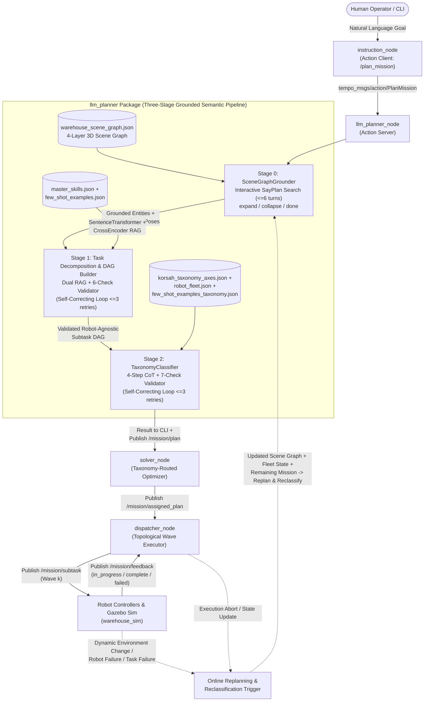

# AGENTS.MD — Onboarding & Architectural Guide for `warehouse_ws` (TEMPO)

Welcome to **`warehouse_ws`**, the ROS 2 (Jazzy) + Gazebo Sim (Harmonic) workspace for **TEMPO** (*Taxonomy-Enforced Multi-Robot Planning and Optimization via Large Language Models*).

This document is the authoritative onboarding and technical reference for AI coding agents and developers working in this repository. Read it before modifying packages, prompts, schemas, solvers, or launch pipelines.

---

## 1. Project Overview & Core Thesis

### 1.1 The Problem in LLM-Driven Multi-Robot Systems (MRS)
Multi-Robot Task Allocation (MRTA) in warehouse and industrial logistics requires both **high-level semantic understanding** (interpreting ambiguous human instructions, grounding entities in a 3D environment, decomposing goals into dependency-aware subtasks) and **combinatorial optimization** (allocating and scheduling tasks across heterogeneous robots subject to payload, spatial, precedence, and coalition constraints).

As surveyed in **Li et al. (2026)** (*Large Language Models for Multi-Robot Systems: A Survey*) and demonstrated empirically in **Obata et al. (2024)** (*LiP-LLM*), current approaches fall into two extremes:
1. **End-to-End LLM Task Allocators**: Use LLMs to both decompose tasks and assign them to robots. While strong at semantic parsing, LLMs fail at formal combinatorial optimization—exhibiting poor scaling, fragility under numerical variations (weights, distances, capacities), constraint violations, and hallucinations.
2. **Single-Solver Hybrid Architectures** (e.g., DART-LLM, SMART-LLM, LiP-LLM): Use an LLM for task decomposition and delegate allocation to a *single fixed* mathematical formulation (e.g., always running a dependency-aware MILP or skill-matching heuristic). Because MRTA spans a spectrum from polynomial-time linear assignment ($O(mn^2)$) to NP-hard cross-schedule coalition scheduling, a single fixed solver either **over-complicates simple problems** (incurring severe computational latency) or **under-models complex constraints** (failing when multi-robot coalitions or cross-schedule synchronizations arise).

### 1.2 The TEMPO Solution
**TEMPO** bridges semantic planning and combinatorial optimization through a **Taxonomy Classification Layer** grounded in the **iTax taxonomy** (**Korsah, Stentz, & Dias, 2013**, extending **Gerkey & Matarić, 2004**):
1. **Stage 0 — 3D Scene Graph Grounding**: An interactive SayPlan-style navigation loop over a 4-layer hierarchical 3D Scene Graph (`Warehouse -> Zone -> Aisle/Fixture -> Object`) extracts only task-relevant entities, spatial poses, and physical properties (e.g., `weight_kg`).
2. **Stage 1 — RAG-Augmented Task Decomposition & DAG Validation**: Using dual Retrieval-Augmented Generation (semantic skill retrieval + cross-encoder few-shot retrieval), the LLM translates natural language into a robot-agnostic Directed Acyclic Graph (DAG) of atomic subtasks, verified by a 6-check deterministic validator with self-correcting retry loops.
3. **Stage 2 — iTax Taxonomy Classification**: A second LLM reasoning stage inspects the validated DAG, ground-truth object weights, and heterogeneous robot fleet capabilities to classify the mission into one of **7 iTax MRTA subclasses** via a 4-step Chain-of-Thought (CoT) verified by a 7-check deterministic validator.
4. **Taxonomy-Routed Mathematical Optimization (`solver_node`)**: The iTax subclass label deterministically routes the DAG to the exact mathematical solver tailored for that complexity class (e.g., Hungarian algorithm for `ND[ST-SR-IA]`, VRP/m-TSP for `ID[ST-SR-TA]`, MILP/CFSTP for `XD[ST-MR-TA]`).
5. **Wave-Based Topological Dispatch (`dispatcher_node`)**: Executes the assigned DAG wave-by-wave in topological generations, synchronizing parallel robot execution via completion/failure feedback.
6. **Online Replanning & Dynamic Reclassification Loop**: Upon any dynamic environment or execution change (robot breakdown, blocked aisle, dropped object, new high-priority order, or partial mission completion), the system **both replans the DAG and reclassifies the problem into an iTax subclass**, because dynamic changes can cause the remaining problem to **transition to a different iTax subclass**.

---

## 2. Theoretical Foundation & Literature Context

Agents working on prompt engineering, validation rules, or solver implementations must understand the three foundational papers located in `../relevant_doc/`:

### 2.1 Gerkey & Matarić (2004) — Three-Axis MRTA Taxonomy
Formalizes MRTA via utility maximization ($U_{RT} = Q_{RT} - C_{RT}$) across three axes (`R-T-H`):
- **Robot Type (`R`)**:
  - `ST` (*Single-Task Robots*): Capable of executing at most one task at a time. (**All TEMPO warehouse robots are `ST`**).
  - `MT` (*Multi-Task Robots*): Capable of executing multiple tasks concurrently.
- **Task Type (`T`)**:
  - `SR` (*Single-Robot Tasks*): Each task requires exactly 1 robot.
  - `MR` (*Multi-Robot Tasks*): Some tasks require multiple robots simultaneously (a coalition, e.g., cooperative heavy lifting where `object.weight_kg > max(robot.payload_capacity_kg)`).
- **Assignment / Time Horizon Type (`H`)**:
  - `IA` (*Instantaneous Assignment*): Current snapshot allocation with no future queue (`|tasks| <= |available_robots|` and no sequential chains per robot).
  - `TA` (*Time-Extended Assignment*): Robots are allocated ordered sequences/schedules of multiple tasks over time (`|tasks| > |available_robots|` or sequential task chains exist).

*Limitation identified by Korsah et al. (2013)*: The `R-T-H` triplet alone assumes independent agent-task utilities and cannot distinguish whether task costs depend on a robot's other scheduled tasks (routing tours) or other robots' schedules (precedence/synchronization).

### 2.2 Korsah, Stentz, & Dias (2013) — The iTax Taxonomy (`D[R-T-H]`)
Introduces a top-level axis measuring the **Degree of Interrelatedness of Agent-Task Utilities (`D`)**:
- **`ND` (No Dependencies)**: The utility/cost of a robot executing a task is completely independent of any other tasks or robots.
- **`ID` (In-Schedule Dependencies)**: The cost/utility of a task depends on **other tasks on the same robot's schedule** (e.g., multi-stop collection tours, battery/capacity constraints, sequence-dependent travel distances), while separate robots' schedules remain independent of one another.
- **`XD` (Cross-Schedule Dependencies)**: The feasibility or cost of a robot's schedule depends on **the schedules of other robots** (e.g., inter-robot precedence constraints, handoffs, spatial exclusion, or simultaneous multi-robot coalitions for `MR` tasks), while task decomposition itself is fixed prior to allocation.
- **`CD` (Complex Dependencies)**: Multiply decomposable complex tasks where task decomposition and allocation are mutually coupled and must be solved simultaneously. (In TEMPO, Stage 1 resolves decomposition into a fixed atomic DAG first, projecting missions into the 7 `ND`, `ID`, and `XD` subclasses below).

### 2.3 The 7 Target iTax Subclasses in TEMPO

| iTax Subclass | Complexity | Physical & Structural Meaning in TEMPO | Canonical Mathematical Formulation / Solver |
| :--- | :--- | :--- | :--- |
| **`ND[ST-SR-IA]`** | **P** ($O(mn^2)$) | Single-robot tasks (`weight <= max_payload`), no robot takes >1 task (`num_tasks <= num_robots`, no chains), independent utilities. | **Linear Sum Assignment Problem (LSAP)** — Hungarian / Kuhn-Munkres or Auction Algorithm |
| **`ND[ST-SR-TA]`** | **P** | Single-robot tasks, robots take multiple tasks over time (`num_tasks > num_robots` or independent chains), but task costs are strictly additive/independent of visit order. | **Cloned-Agent LSAP** / Linear Bottleneck Assignment (LBAP) |
| **`ID[ST-SR-TA]`** | **NP-Hard** | Single-robot tasks over an extended schedule where **intra-robot routing order matters** (e.g., collecting items from multiple aisles before delivering to packing) or robot capacity budgets apply, with no inter-robot dependencies. | **Vehicle Routing Problem (VRP) / m-TSP / GAP** or Unrelated Parallel Machine Scheduling ($R \parallel \sum w_j C_j$) |
| **`XD[ST-SR-IA]`** | **NP-Hard** | Instantaneous assignment (1 task per robot), single-robot tasks, but **inter-robot side constraints** couple the choices (e.g., mutual exclusion, synchronized simultaneous placement, shared resource contention). | **Assignment Problem with Side Constraints (APSC)** — 0-1 Integer Linear Programming (ILP) |
| **`XD[ST-SR-TA]`** | **NP-Hard** | Time-extended schedules of single-robot tasks where **different robots' schedules are coupled by precedence or handoff constraints** (e.g., Robot A brings an item to a staging table so stationary Arm B can sort/pack it). | **$R \mid prec \mid \sum w_j C_j$** / Precedence-Constrained m-TSP / VRP with Synchronization (MILP) |
| **`XD[ST-MR-IA]`** | **NP-Hard** | Instantaneous assignment where at least one task is a **Multi-Robot (`MR`) task** (e.g., `object.weight_kg > max_single_robot_payload` requiring a simultaneous multi-robot coalition), and each robot executes at most 1 task. | **Set Partitioning Problem (SPP)** / Coalition Structure Generation (ILP / Branch-and-Price) |
| **`XD[ST-MR-TA]`** | **NP-Hard** | Time-extended mission combining **multi-robot (`MR`) coalition tasks** (heavy payloads) with sequential task chains (`navigate -> cooperative pick -> place`) and/or cross-schedule precedence. | **Coalition Formation with Spatial & Temporal Constraints (CFSTP)** / Multi-Mode Multiprocessor Task Scheduling (MILP) |

> [!IMPORTANT]
> **Critical Classification Rule (`MR` implies `XD`)**: Under Korsah et al. (2013), whenever `task_model == "MR"` (an object exceeds every individual eligible robot's payload capacity or a task explicitly requires multiple robots simultaneously), `dependency` **MUST** be `"XD"`, because forming a coalition couples the schedules of the participating robots at that point in time.

---

## 3. System Architecture & End-to-End Pipeline



### 3.1 The Online Replanning & Dynamic Reclassification Loop
A core architectural pillar of TEMPO is **closed-loop online replanning with dynamic taxonomy reclassification**:
1. **Why Replanning Requires Reclassification**:
   In a dynamic warehouse, the environment and fleet state evolve during mission execution. When a disruption occurs, the residual optimization problem does **not** necessarily stay in the same iTax subclass as the original mission:
   - **`ND[ST-SR-IA]` $\rightarrow$ `ND[ST-SR-TA]` or `ID[ST-SR-TA]`**: If 3 robots are executing 3 independent tasks (`ND[ST-SR-IA]`) and 1 robot suffers a hardware fault or battery depletion, the remaining 2 robots must now sequence the 3 tasks over time (`TA`), potentially introducing intra-schedule routing dependencies (`ID[ST-SR-TA]`).
   - **`XD[ST-MR-TA]` $\rightarrow$ `ND[ST-SR-IA]` / `ID[ST-SR-TA]`**: Once a heavy collaborative lift (`MR` task) is completed and a subsequent subtask fails, the remaining unexecuted tasks may only involve light single-robot (`SR`) items—allowing the replanner to downgrade the problem from an expensive `XD[ST-MR-TA]` MILP to a fast `ND` or `ID` solver.
   - **`ND[ST-SR-TA]` $\rightarrow$ `XD[ST-SR-TA]`**: If a mobile robot's gripper or wheel fails mid-delivery or an aisle becomes blocked, requiring a relay handoff at a staging zone to another robot or stationary arm, an independent schedule becomes coupled via cross-schedule precedence (`XD`).
   - **Payload / Fleet Degradation**: If the high-payload `robotic_arm` (`15.0 kg`) goes offline, a `12.0 kg` object that was previously a Single-Robot (`SR`) task for the arm now exceeds the `10.0 kg` payload limit of the remaining `mobile_robot` units—transitioning the task model from `SR` to `MR` (`XD[ST-MR-*]`).
2. **How the Loop Operates**:
   - **Trigger Conditions**:
     - A subtask reports `status in {"failed", "failure", "error", "rejected"}` on `/mission/feedback`.
     - Fleet health/availability changes (`robot_fleet.json` / runtime fleet state update).
     - Scene graph updates (blocked aisle/zone, moved/missing object, newly spawned dynamic order).
   - **Execution Flow**:
     1. `dispatcher_node` halts further wave dispatch for the superseded `plan_id` and records completed subtasks (`completed_tasks`) alongside the failure/environment delta.
     2. The updated world state (updated `warehouse_scene_graph` state + updated active `robot_fleet` state + remaining mission objective excluding already-completed irreversible effects) is fed back into `MissionPlanner.plan_and_classify()`.
     3. **Stage 0** re-grounds against the updated scene graph; **Stage 1** synthesizes and validates the new residual subtask DAG; **Stage 2** re-evaluates the 4 iTax axes (`robot_model`, `task_model`, `time_horizon`, `dependency`) from scratch on the residual DAG and current fleet to output a potentially new `itax_subclass`.
     4. `solver_node` receives the new `/mission/plan` envelope (with a new `plan_id` and updated `itax_subclass`) and invokes the solver matched to the **new** subclass.

---

## 4. Repository Structure & Package Reference

```text
warehouse_ws/
├── AGENTS.MD                          # This onboarding & architectural guide
├── README.md                          # Quickstart & workspace overview
├── docker/                            # Containerized ROS 2 Jazzy + Gazebo Harmonic setup
│   ├── Dockerfile
│   ├── docker-compose.yml
│   ├── build.sh                       # Builds warehouse_ws:latest Docker image
│   ├── workspace.sh                   # Starts/enters container (mounts ../src live)
│   ├── entrypoint.sh
│   └── bash_aliases.txt               # Aliases: sim, build, ws, src, cleanup
└── src/
    ├── tempo_msgs/                    # Custom ROS 2 action/message definitions (ament_cmake)
    ├── instruction_module/            # Interactive CLI mission client (ament_python)
    ├── llm_planner/                   # Stage 0, Stage 1, Stage 2 LLM pipeline (ament_python)
    ├── solver_node/                   # Taxonomy-routed task allocation solvers (ament_python)
    ├── dispatcher_node/               # Wave-based topological DAG executor (ament_python)
    └── warehouse_sim/                 # Gazebo Harmonic world, SDF models, launch (ament_python)
```

---

### 4.1 `tempo_msgs` (`src/tempo_msgs/`)
Custom ROS 2 interface package built with `ament_cmake` and `rosidl_default_generators`.
- **[PlanMission.action](file:///home/taha/Desktop/FYP/warehouse_ws/src/tempo_msgs/action/PlanMission.action)**:
  ```idl
  # Goal
  string mission_instruction
  ---
  # Result
  string status          # "ok" | "clarification_needed" | "infeasible" | "error"
  string reason          # Explanation when status != "ok"
  string itax_subclass   # e.g., "ND[ST-SR-IA]", "XD[ST-MR-TA]", or "" on rejection
  string plan_json       # Full serialized JSON result dictionary
  string[] errors        # Validation error strings if retries exhausted
  ---
  # Feedback
  ```

---

### 4.2 `instruction_module` (`src/instruction_module/`)
Interactive CLI front-end for human operators.
- **[instruction_node.py](file:///home/taha/Desktop/FYP/warehouse_ws/src/instruction_module/instruction_module/instruction_node.py)** (`InstructionNode`):
  - ROS 2 Action Client connected to `/plan_mission` (`tempo_msgs/action/PlanMission`).
  - Prompts the user via stdin for a natural-language warehouse instruction.
  - Handles the 4 terminal statuses returned by `llm_planner`:
    - `ok`: Prints the classified `itax_subclass` and subtask count, then prompts for the next mission.
    - `clarification_needed`: Prints `reason` (e.g., ambiguous object/destination) and immediately prompts the user for a clarified instruction.
    - `infeasible`: Prints `reason` (e.g., requested object does not exist in the warehouse) and prompts for a new mission.
    - `error`: Prints any validation/API errors (`errors`).

---

### 4.3 `llm_planner` (`src/llm_planner/`)
The core intelligence package implementing the 3-stage grounded planning and taxonomy classification pipeline.

#### Key Modules in `src/llm_planner/llm_planner/`:
| File | Responsibility |
| :--- | :--- |
| **[config.py](file:///home/taha/Desktop/FYP/warehouse_ws/src/llm_planner/llm_planner/config.py)** | Resolves paths to `knowledge_base/` (via `ament_index_python` or source fallback), loads `.env` from the source tree (`src/llm_planner/.env`), defines `FEW_SHOT_K = 4`, `MAX_RETRIES = 3`, `TEMPERATURE = 0.0`, and default models (`gemini-3.1-flash-lite` for Gemini, `openai/gpt-oss-120b` for Groq). |
| **[llm_client.py](file:///home/taha/Desktop/FYP/warehouse_ws/src/llm_planner/llm_planner/llm_client.py)** | Provider-agnostic `LLMClient` supporting `gemini` (`google-genai` SDK with `response_mime_type="application/json"`) and `groq` (`groq` SDK with `response_format={"type": "json_object"}`). Performs deterministic markdown fence stripping and JSON dict verification. |
| **[scene_graph_grounder.py](file:///home/taha/Desktop/FYP/warehouse_ws/src/llm_planner/llm_planner/scene_graph_grounder.py)** | **Stage 0**: Implements `SceneGraphNavigator` (stateful view over the 4-layer scene graph) and `SceneGraphGrounder` (interactive LLM search loop up to `MAX_SEARCH_TURNS = 6` with actions `expand`, `collapse`, `done`). Enforces a guardrail preventing premature `done` if aisles are expanded without expanding any shelf fixtures. Returns `GroundedSceneResult` containing `prompt_text`, `valid_entities` (`{"objects": set, "locations": set}`), and `objects_metadata` (`weight_kg`, `pose`, `hosted_by`). |
| **[rag/skill_retrieval.py](file:///home/taha/Desktop/FYP/warehouse_ws/src/llm_planner/llm_planner/rag/skill_retrieval.py)** | `CosineSkillRetriever`: Embeds skills from `master_skills.json` using `SentenceTransformer("all-mpnet-base-v2")` and retrieves the top-$k$ relevant robot primitive skills by cosine similarity. |
| **[rag/few_shot_retrieval.py](file:///home/taha/Desktop/FYP/warehouse_ws/src/llm_planner/llm_planner/rag/few_shot_retrieval.py)** | `CosineFewShotRetriever`: Scores examples in `few_shot_examples.json` using `CrossEncoder("cross-encoder/ms-marco-MiniLM-L-6-v2")` (`top_k = 4`) while **guaranteeing class coverage** (always includes at least 1 `"ok"` decomposition example and at least 1 `"clarification_needed"` / `"infeasible"` rejection example). |
| **[prompt_builder.py](file:///home/taha/Desktop/FYP/warehouse_ws/src/llm_planner/llm_planner/prompt_builder.py)** | **Stage 1 Prompt ($P = (I, E, S, F)$)**: Combines system instructions ($I$), Stage 0 grounded scene graph entities & distances ($E$), retrieved skills & fleet summary ($S$), and retrieved few-shot examples ($F$). Also provides `build_retry_prompt()` to inject deterministic validator errors back into the LLM context. |
| **[dag_builder.py](file:///home/taha/Desktop/FYP/warehouse_ws/src/llm_planner/llm_planner/dag_builder.py)** | **Stage 1 Validator**: Builds a `networkx.DiGraph` (`build_dag`) where edges point `dep -> task_id`, and runs **6 deterministic validation checks** (`validate_plan`):<br/>1. `DUPLICATE_TASK_ID`<br/>2. `CYCLE_DETECTED` (`nx.is_directed_acyclic_graph`)<br/>3. `INVALID_DEPENDENCY` (all `dependencies` must reference existing `task_id`s)<br/>4. `INVALID_SKILLS_COUNT` / `INVALID_SKILL` (**strictly 1 primitive skill per atomic subtask**, and skill must exist in `master_skills.json`)<br/>5. `MISSING_ARGS` / `EXTRA_ARGS` (exact argument schema match against `master_skills.json`)<br/>6. `UNGROUNDED_OBJECT` / `UNGROUNDED_LOCATION` (every object and location argument must exist in Stage 0 `valid_entities`). |
| **[taxonomy_prompt_builder.py](file:///home/taha/Desktop/FYP/warehouse_ws/src/llm_planner/llm_planner/taxonomy_prompt_builder.py)** | **Stage 2 Prompt**: Extracts ground-truth `weight_kg` for every object referenced in the Stage 1 DAG (`extract_objects_dict`), formats fleet payload capacities and quantities, injects `korsah_taxonomy_axes.json` + all 7 exemplars from `few_shot_examples_taxonomy.json`, and instructs the LLM to execute a 4-step Chain-of-Thought (`step_1_robot_model`, `step_2_task_model`, `step_3_time_horizon`, `step_4_dependency`). |
| **[taxonomy_validator.py](file:///home/taha/Desktop/FYP/warehouse_ws/src/llm_planner/llm_planner/taxonomy_validator.py)** | **Stage 2 Validator**: Runs **7 deterministic checks** (`validate_taxonomy_output`):<br/>1. Top-level keys (`reasoning`, `axes`, `subclass`)<br/>2. Dictionary type validation<br/>3. **Separation of Concerns** (forbids `matched_solver` — the LLM must never pick the solver)<br/>4. Non-empty 4-step CoT reasoning fields<br/>5. Valid axis values (`ST/MT`, `SR/MR`, `IA/TA`, `ND/ID/XD/CD`)<br/>6. Mathematical string consistency (`subclass == f"{dep}[{rm}-{tm}-{th}]"`)<br/>7. Whitelist membership in the 7 `TARGET_SUBCLASSES`. |
| **[taxonomy_classifier.py](file:///home/taha/Desktop/FYP/warehouse_ws/src/llm_planner/llm_planner/taxonomy_classifier.py)** | `TaxonomyClassifier`: Orchestrates Stage 2 LLM calls and `validate_taxonomy_output` across up to `MAX_RETRIES = 3` self-correction attempts. |
| **[orchestrator.py](file:///home/taha/Desktop/FYP/warehouse_ws/src/llm_planner/llm_planner/orchestrator.py)** | `MissionPlanner`: End-to-end coordinator chaining Stage 0 (`SceneGraphGrounder`) $\rightarrow$ Stage 1 (`PromptBuilder` + `LLMClient` + `dag_builder.validate_plan`) $\rightarrow$ Stage 2 (`TaxonomyClassifier.classify`). Exposes `orchestrate_mission(instruction)` and `plan_and_classify(instruction)`. |
| **[planner_node.py](file:///home/taha/Desktop/FYP/warehouse_ws/src/llm_planner/llm_planner/planner_node.py)** | `LLMPlannerNode`: ROS 2 node hosting the `/plan_mission` Action Server and publishing validated plans (with a generated UUID `plan_id`) to `/mission/plan` (`std_msgs/String`). |

#### Knowledge Base (`src/llm_planner/knowledge_base/`) & Offline Scene Graph Tool (`src/llm_planner/tools/`):
- **[warehouse_scene_graph.json](file:///home/taha/Desktop/FYP/warehouse_ws/src/llm_planner/knowledge_base/warehouse_scene_graph.json)**: Auto-generated 4-layer scene graph of `warehouse.sdf` containing **5 functional zones** (`picking_zone` with `aisle_1`..`aisle_7`, `packing_zone`, `staging_area`, `hazmat_zone`, `maintenance_zone`), **110 fixtures** (shelves, tables, pallets, cardboard boxes, clutter), **614 manipulable objects** with ground-truth 3D poses and `weight_kg`, and a precomputed Euclidean **inter-zone distance matrix**.
- **[parse_sdf_to_scene_graph.py](file:///home/taha/Desktop/FYP/warehouse_ws/src/llm_planner/tools/parse_sdf_to_scene_graph.py)**: Offline parser that reads `src/warehouse_sim/worlds/warehouse.sdf`, [zone_config.json](file:///home/taha/Desktop/FYP/warehouse_ws/src/llm_planner/tools/zone_config.json), and [model_weights.json](file:///home/taha/Desktop/FYP/warehouse_ws/src/llm_planner/tools/model_weights.json), resolves Gazebo `<plugin name="gazebo::gz::systems::DetachableJoint">` attachments and vertical Z-stacking (`on_top_of`), and outputs `warehouse_scene_graph.json`.
- **[master_skills.json](file:///home/taha/Desktop/FYP/warehouse_ws/src/llm_planner/knowledge_base/master_skills.json)**: Defines the 3 atomic robot primitive skills:
  - `navigate_to(robot, target_location)`
  - `pick(robot, object_id, grab_location)`
  - `place(robot, object_id, place_location)`
- **[robot_fleet.json](file:///home/taha/Desktop/FYP/warehouse_ws/src/llm_planner/knowledge_base/robot_fleet.json)** & **[robot_registry.json](file:///home/taha/Desktop/FYP/warehouse_ws/src/llm_planner/knowledge_base/robot_registry.json)**:
  - `mobile_robot` (quantity: `2`, `payload_capacity_kg: 10.0`, `max_speed_m_s: 1.0`, skills: `["navigate_to", "pick", "place"]`) -> instances `mobile_robot_1`, `mobile_robot_2`.
  - `robotic_arm` (quantity: `1`, `payload_capacity_kg: 15.0`, `max_speed_m_s: 0.0` [stationary], skills: `["pick", "place"]`) -> instance `robotic_arm_1`.
- **[korsah_taxonomy_axes.json](file:///home/taha/Desktop/FYP/warehouse_ws/src/llm_planner/knowledge_base/korsah_taxonomy_axes.json)**: Formal definitions of the 4 iTax axes (`robot_model`, `task_model`, `time_horizon`, `dependency`) and the 7 target subclasses.
- **[few_shot_examples.json](file:///home/taha/Desktop/FYP/warehouse_ws/src/llm_planner/knowledge_base/few_shot_examples.json)** & **[few_shot_examples_taxonomy.json](file:///home/taha/Desktop/FYP/warehouse_ws/src/llm_planner/knowledge_base/few_shot_examples_taxonomy.json)**: Few-shot exemplars for Stage 1 decomposition and Stage 2 iTax classification (1 exemplar per target subclass).

---

### 4.4 `solver_node` (`src/solver_node/`)
Receives the validated, taxonomy-classified DAG on `/mission/plan` and allocates specific robot instances (`mobile_robot_1`, `mobile_robot_2`, `robotic_arm_1`) to every subtask.
- **[solver_node.py](file:///home/taha/Desktop/FYP/warehouse_ws/src/solver_node/solver_node/solver_node.py)** (`SolverNode`):
  - Subscribes to `/mission/plan` (`std_msgs/String`).
  - Validates incoming JSON envelope (`plan_id`, `status == "ok"`, non-empty `subtasks`, valid DAG via `llm_planner.dag_builder.build_dag`).
  - Reads `itax_subclass` and dispatches the subtask DAG to the solver module, then publishes the assigned plan to `/mission/assigned_plan` (`std_msgs/String`).
- **[naive_solver.py](file:///home/taha/Desktop/FYP/warehouse_ws/src/solver_node/solver_node/naive_solver.py)**:
  - Current baseline allocator (`allocate_subtasks`): extracts weakly connected components (dependency chains) in the subtask DAG, orders them deterministically, and assigns each connected chain to a single robot via round-robin over `fleet_robots` (`["mobile_robot_1", "mobile_robot_2"]`) so sequential chains (`navigate_to -> pick -> navigate_to -> place`) stay on the same robot.
  - **Active Development Area**: Adding and wiring the 7 dedicated mathematical solvers keyed by `itax_subclass` (Hungarian/LSAP for `ND[ST-SR-IA]`, Cloned-Agent LSAP for `ND[ST-SR-TA]`, VRP/m-TSP/GAP for `ID[ST-SR-TA]`, APSC ILP for `XD[ST-SR-IA]`, Precedence-Constrained m-TSP/MILP for `XD[ST-SR-TA]`, Set Partitioning for `XD[ST-MR-IA]`, and CFSTP MILP for `XD[ST-MR-TA]`).

---

### 4.5 `dispatcher_node` (`src/dispatcher_node/`)
Coordinates parallel and sequential execution of the allocated DAG across the robot fleet.
- **[dispatcher_node.py](file:///home/taha/Desktop/FYP/warehouse_ws/src/dispatcher_node/dispatcher_node/dispatcher_node.py)** (`DispatcherNode`):
  - Subscribes to `/mission/assigned_plan` (`std_msgs/String`) and `/mission/feedback` (`std_msgs/String`).
  - Reconstructs the NetworkX `DiGraph` (`dep -> task_id`) and computes parallel execution waves via `nx.topological_generations(dag)`.
  - Dispatches Wave $k$ by publishing each subtask in the wave to `/mission/subtask` (`std_msgs/String`).
  - Tracks per-subtask execution feedback on `/mission/feedback`:
    - Ignores intermediate `in_progress` updates after logging.
    - Marks tasks finished on `stage == "complete"` (`status in {"ok", "success", "completed", "complete"}`).
    - **Wave Barrier**: Advances to Wave $k+1$ only when **every** subtask in Wave $k$ has reported completion.
    - **Failure Handling & Replanning Hook**: If any subtask reports `status in {"failed", "failure", "error", "rejected"}` or `stage == "failed"`, aborts the active plan (`_reset_mission_state`)—serving as the trigger point for the **Online Replanning & Reclassification Loop**.

---

### 4.6 `warehouse_sim` (`src/warehouse_sim/`)
Gazebo Sim (Harmonic) simulation environment.
- **[warehouse.launch.py](file:///home/taha/Desktop/FYP/warehouse_ws/src/warehouse_sim/launch/warehouse.launch.py)**: Sets `GZ_SIM_RESOURCE_PATH`, launches `ros_gz_sim` with `worlds/warehouse.sdf`, and starts `ros_gz_bridge` for `/clock`.
- **[worlds/warehouse.sdf](file:///home/taha/Desktop/FYP/warehouse_ws/src/warehouse_sim/worlds/warehouse.sdf)**: Full 3D warehouse world containing 724 model instances across the 5 zones (`picking_zone`, `packing_zone`, `staging_area`, `hazmat_zone`, `maintenance_zone`).
- **`models/`**: 25+ 3D asset directories (`shelf`, `pallet`, `cardboard_box`, `fire_extinguisher`, `first_aid_kit`, ` toolbox_metal`, `propane_tank`, `acid_bottle`, `car_wheel`, `dumbbell`, etc.).

---

## 5. ROS 2 Communication Contracts & JSON Schemas

All topic payloads use `std_msgs/msg/String` containing UTF-8 JSON objects.

### 5.1 `/mission/plan` (Published by `llm_planner_node`, Subscribed by `solver_node`)
```json
{
  "plan_id": "9f8c2b1a-...",
  "status": "ok",
  "itax_subclass": "ID[ST-SR-TA]",
  "taxonomy_axes": {
    "robot_model": "ST",
    "task_model": "SR",
    "time_horizon": "TA",
    "dependency": "ID"
  },
  "taxonomy_reasoning": {
    "step_1_robot_model": "...",
    "step_2_task_model": "...",
    "step_3_time_horizon": "...",
    "step_4_dependency": "..."
  },
  "subtasks": [
    {
      "task_id": "T1",
      "required_skills": ["navigate_to"],
      "args": { "target_location": "shelf_1_a_level_2" },
      "dependencies": []
    },
    {
      "task_id": "T2",
      "required_skills": ["pick"],
      "args": { "object_id": "first_aid_kit_1", "grab_location": "shelf_1_a_level_2" },
      "dependencies": ["T1"]
    }
  ],
  "errors": []
}
```

### 5.2 `/mission/assigned_plan` (Published by `solver_node`, Subscribed by `dispatcher_node`)
Identical envelope to `/mission/plan`, except each subtask in `subtasks` now includes an assigned `"robot"` field (or list/coalition for `MR` tasks):
```json
{
  "plan_id": "9f8c2b1a-...",
  "status": "ok",
  "itax_subclass": "ID[ST-SR-TA]",
  "subtasks": [
    {
      "task_id": "T1",
      "robot": "mobile_robot_1",
      "required_skills": ["navigate_to"],
      "args": { "target_location": "shelf_1_a_level_2" },
      "dependencies": []
    }
  ]
}
```

### 5.3 `/mission/subtask` (Published by `dispatcher_node`, Subscribed by Robot Controllers)
```json
{
  "plan_id": "9f8c2b1a-...",
  "task_id": "T1",
  "robot": "mobile_robot_1",
  "required_skills": ["navigate_to"],
  "args": { "target_location": "shelf_1_a_level_2" }
}
```

### 5.4 `/mission/feedback` (Published by Robot Controllers, Subscribed by `dispatcher_node`)
```json
{
  "plan_id": "9f8c2b1a-...",
  "task_id": "T1",
  "robot": "mobile_robot_1",
  "stage": "complete",
  "status": "ok"
}
```
*(Valid `stage` values: `"in_progress"`, `"complete"`, `"failed"`. Failure `status` values that trigger mission abort / online replanning: `"failed"`, `"failure"`, `"error"`, `"rejected"`).*

---

## 6. Development Environment, Building & Testing

### 6.1 Docker Workflow (`docker/`)
The project runs inside a Ubuntu 24.04 + ROS 2 Jazzy + Gazebo Harmonic container where `warehouse_ws/src` is bind-mounted live into `/root/warehouse_ws/src`.
```bash
# 1. Build the Docker image (only needed once or when Dockerfile changes)
cd docker && ./build.sh

# 2. Launch or attach to the running container
cd docker && ./workspace.sh
```
Inside the container, `docker/bash_aliases.txt` provides:
- `build`: Runs `colcon build --symlink-install` from `/root/warehouse_ws` and re-sources `install/setup.bash`.
- `sim`: Runs `ros2 launch warehouse_sim warehouse.launch.py`.
- `ws` / `src`: Quick directory jumps to `/root/warehouse_ws` and `/root/warehouse_ws/src`.
- `cleanup`: Kills lingering Gazebo (`gz sim`), `rviz2`, and `ros2` processes.

### 6.2 LLM API Configuration (`.env`)
Copy [src/llm_planner/.env.example](file:///home/taha/Desktop/FYP/warehouse_ws/src/llm_planner/.env.example) to `src/llm_planner/.env`:
```env
LLM_PROVIDER="gemini"          # "gemini" or "groq"
LLM_MODEL=""                   # Optional override (defaults: gemini-3.1-flash-lite / openai/gpt-oss-120b)
GEMINI_API_KEY="your-key"
GROQ_API_KEY="your-key"
```
> [!CAUTION]
> **Security Rule**: `.env` is intentionally NOT listed in `src/llm_planner/setup.py` `data_files` so API keys are never copied into `install/` or committed to Git. `config.py` resolves `.env` directly from the source tree (`src/llm_planner/.env`) or via the `LLM_PLANNER_ENV_FILE` environment variable. Never add `.env` to `setup.py`.

### 6.3 Running the Full Pipeline (4 Terminals)
```bash
# Terminal 1: Launch LLM Planner Action Server
ros2 launch llm_planner planner.launch.py

# Terminal 2: Launch Task Allocation Solver Node
ros2 launch solver_node solver.launch.py

# Terminal 3: Launch Topological Wave Dispatcher Node
ros2 run dispatcher_node dispatcher_node

# Terminal 4: Run Interactive CLI Instruction Client
ros2 run instruction_module instruction_node
```

### 6.4 Regenerating the 3D Scene Graph
Whenever `src/warehouse_sim/worlds/warehouse.sdf`, `tools/zone_config.json`, or `tools/model_weights.json` is modified, regenerate `knowledge_base/warehouse_scene_graph.json`:
```bash
python3 src/llm_planner/tools/parse_sdf_to_scene_graph.py
```

### 6.5 Running Unit & Linter Tests
All packages use `pytest` via `ament_pytest`. You can run tests without live LLM API keys (all LLM calls in `test_stage1.py`, `test_stage2.py`, and `test_scene_graph_grounder.py` are mocked or test deterministic validators):
```bash
# Build packages first
colcon build --symlink-install
source install/setup.bash

# Run all unit tests in llm_planner and solver_node
pytest src/llm_planner/test/ src/solver_node/test/

# Or run via colcon test (includes flake8, pep257, xmllint, copyright checks)
colcon test --packages-select tempo_msgs instruction_module llm_planner solver_node dispatcher_node warehouse_sim
colcon test-result --verbose
```

---

## 7. Architectural Guardrails & Rules for Future Agents

When modifying or extending this repository, **always** enforce these invariants:

1. **Strict Separation of Concerns Across Pipeline Stages**:
   - **Stage 1 (`prompt_builder.py`, `dag_builder.py`) is strictly robot-agnostic**: Subtasks in Stage 1 must NEVER assign a specific robot ID (`mobile_robot_1`, `robotic_arm_1`) or include a `robot` argument. Robot allocation belongs exclusively to `solver_node`.
   - **Stage 2 (`taxonomy_classifier.py`, `taxonomy_validator.py`) classifies the problem, NOT the solver**: Check 3 in `taxonomy_validator.py` explicitly rejects any LLM output containing `"matched_solver"`. The mapping from `itax_subclass` to a mathematical solver is a deterministic software routing step in `solver_node`.
2. **One Atomic Skill Per Subtask**:
   - Check 4 in `dag_builder.py` enforces `len(required_skills) == 1`. Composite actions (e.g., "fetch X and place at Y") must be decomposed into atomic subtasks (`T1: navigate_to`, `T2: pick`, `T3: navigate_to`, `T4: place`) linked by `dependencies`.
3. **Zero Hallucinated Entities (Check 6 Grounding)**:
   - Every `object_id`, `target_location`, `grab_location`, and `place_location` in a Stage 1 plan is validated against the `valid_entities` set extracted by Stage 0 (`SceneGraphGrounder`) from `warehouse_scene_graph.json`.
   - In Stage 0 (`scene_graph_grounder.py`), the LLM must expand down to Layer 4 (fixtures/shelves) to discover objects before calling `done`. Do not weaken the premature-`done` guardrail in `SceneGraphGrounder.ground_instruction()`.
4. **Physical Payload Grounding Drives `SR` vs. `MR` (`task_model`)**:
   - Never let Stage 2 guess object weights from object names. `extract_objects_dict()` in `taxonomy_prompt_builder.py` injects ground-truth `weight_kg` from Stage 0 `objects_metadata` alongside `robot_fleet.json` payload capacities (`10.0 kg` for mobile robots, `15.0 kg` for stationary arm).
   - If an object requires transport (`navigate_to`) and `weight_kg > 10.0` (the mobile robot payload limit), or if `weight_kg > 15.0` overall, it requires a multi-robot coalition (`task_model = "MR"` and `dependency = "XD"`).
5. **Online Replanning Must Always Trigger Stage 2 Reclassification**:
   - When implementing or modifying the online replanning loop (triggered by `/mission/feedback` failures, robot dropouts, or dynamic environment changes), **never bypass Stage 2 (`TaxonomyClassifier`)** by reusing the old plan's `itax_subclass`. Always re-run `plan_and_classify` on the updated world/fleet state and residual mission so subclass transitions (e.g., `ND[ST-SR-IA]` $\rightarrow$ `ID[ST-SR-TA]` or `XD[ST-MR-TA]` $\rightarrow$ `ND[ST-SR-TA]`) are properly detected and routed to the appropriate solver.
