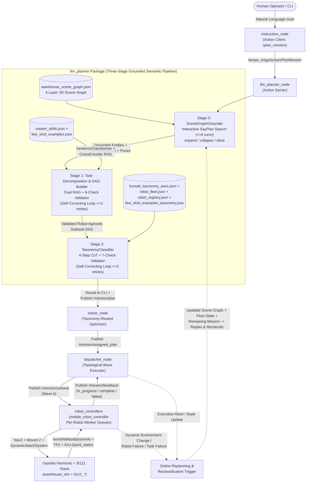

# AGENTS.MD — Onboarding & Architectural Guide for `warehouse_ws` (TEMPO)

Welcome to **`warehouse_ws`**, the ROS 2 (Jazzy) + Gazebo Sim (Harmonic) workspace for **TEMPO** (*Taxonomy-Enforced Multi-Robot Planning and Optimization via Large Language Models*).

This document is the authoritative onboarding and technical reference for AI coding agents and developers working in this repository. Read it before modifying packages, prompts, schemas, solvers, robot controllers, or launch pipelines.

---

## 0. Agent Onboarding: Required Reading Order

When starting a new session in this workspace, read the project materials **in this exact order** before writing code or designing changes:

1. **Step 1 — Foundational Literature (`../relevant_doc/`)**:
   Read all 5 reference papers in `../relevant_doc/` to understand the MRTA taxonomies, LLM-MRS survey, and 3D scene graph grounding methods:
   - `../relevant_doc/Gerkey and Matarić - 2004 - A Formal Analysis and Taxonomy of Task Allocation in Multi-Robot Systems.pdf`
   - `../relevant_doc/Korsah et al. - 2013 - A comprehensive taxonomy for multi-robot task allocation.pdf`
   - `../relevant_doc/Li et al. - 2026 - Large Language Models for Multi-Robot Systems A Survey.pdf`
   - `../relevant_doc/Rana et al. - 2023 - SayPlan Grounding Large Language Models using 3D Scene Graphs for Scalable Robot Task Planning.pdf`
   - `../relevant_doc/Ray et al. - 2025 - Structured Interfaces for Automated Reasoning with 3D Scene Graphs.pdf`
2. **Step 2 — Project Specification (`../project_doc/TEMPO.pdf`)**:
   Read `../project_doc/TEMPO.pdf` for the full TEMPO thesis, objectives, scope, and system design.
3. **Step 3 — Workspace Codebase (`src/`)**:
   Inspect the ROS 2 packages in pipeline order (refer to **Section 4** for file-by-file details):
   - Interfaces & Input: `tempo_msgs` $\rightarrow$ `instruction_module`
   - Grounding, Decomposition & Taxonomy: `llm_planner` (Stage 0 `scene_graph_grounder.py`, Stage 1 `prompt_builder.py` + `dag_builder.py`, Stage 2 `taxonomy_classifier.py`, `knowledge_base/`)
   - Allocation & Dispatch: `solver_node` $\rightarrow$ `dispatcher_node`
   - Execution & Simulation: `robot_controllers` $\rightarrow$ `b1z1_description` / `b1z1_control` / `b1z1_moveit_config` / `warehouse_sim` $\rightarrow$ `tempo_bringup`

---

## 1. Project Overview & Core Thesis

### 1.1 The Problem in LLM-Driven Multi-Robot Systems (MRS)
Multi-Robot Task Allocation (MRTA) in warehouse and industrial logistics requires both **high-level semantic understanding** (interpreting ambiguous human instructions, grounding entities in a 3D environment, decomposing goals into dependency-aware subtasks) and **combinatorial optimization** (allocating and scheduling tasks across heterogeneous robots subject to payload, spatial, precedence, and coalition constraints).

As surveyed in **Li et al. (2026)** (*Large Language Models for Multi-Robot Systems: A Survey*) and demonstrated empirically in **Obata et al. (2024)** (*LiP-LLM*), current approaches fall into two extremes:
1. **End-to-End LLM Task Allocators**: Use LLMs to both decompose tasks and assign them to robots. While strong at semantic parsing, LLMs fail at formal combinatorial optimization—exhibiting poor scaling, fragility under numerical variations (weights, distances, capacities), constraint violations, and hallucinations.
2. **Single-Solver Hybrid Architectures** (e.g., DART-LLM, SMART-LLM, LiP-LLM): Use an LLM for task decomposition and delegate allocation to a *single fixed* mathematical formulation (e.g., always running a dependency-aware MILP or skill-matching heuristic). Because MRTA spans a spectrum from polynomial-time linear assignment ($O(mn^2)$) to NP-hard cross-schedule coalition scheduling, a single fixed solver either **over-complicates simple problems** (incurring severe computational latency) or **under-models complex constraints** (failing when multi-robot coalitions or cross-schedule synchronizations arise).

### 1.2 The TEMPO Solution
**TEMPO** bridges semantic planning and combinatorial optimization through a **Taxonomy Classification Layer** grounded in the **iTax taxonomy** (**Korsah, Stentz, & Dias, 2013**, extending **Gerkey & Matarić, 2004**):
1. **Stage 0 — 3D Scene Graph Grounding**: An interactive SayPlan-style navigation loop over a 4-layer hierarchical 3D Scene Graph (`Warehouse -> Zone -> Aisle/Fixture -> Object`) extracts only task-relevant entities, spatial poses, and physical properties (e.g., `weight_kg`).
2. **Stage 1 — RAG-Augmented Task Decomposition & DAG Validation**: Using dual Retrieval-Augmented Generation (semantic skill retrieval + cross-encoder few-shot retrieval), the LLM translates natural language into a robot-agnostic Directed Acyclic Graph (DAG) of atomic subtasks, verified by a 6-check deterministic validator with self-correcting retry loops.
3. **Stage 2 — iTax Taxonomy Classification**: A second LLM reasoning stage inspects the validated DAG, ground-truth object weights, and heterogeneous robot fleet capabilities to classify the mission into one of **7 iTax MRTA subclasses** via a 4-step Chain-of-Thought (CoT) verified by a 7-check deterministic validator.
4. **Taxonomy-Routed Mathematical Optimization (`solver_node`)**: The iTax subclass label deterministically routes the DAG to the exact mathematical solver tailored for that complexity class (e.g., Hungarian algorithm for `ND[ST-SR-IA]`, VRP/m-TSP for `ID[ST-SR-TA]`, MILP/CFSTP for `XD[ST-MR-TA]`).
5. **Wave-Based Topological Dispatch (`dispatcher_node`)**: Executes the assigned DAG wave-by-wave in topological generations, synchronizing parallel robot execution via completion/failure feedback.
6. **Multi-Robot Simulation & Execution (`robot_controllers` + `b1z1_*` + `warehouse_sim`)**: Executes atomic subtasks (`navigate_to`, `pick`, `place`) on heterogeneous mobile manipulators (Unitree B1 + Z1 quadruped manipulator, plus Husky A200 + UR5e profile support) via Nav2, MoveIt 2, CHAMP locomotion, and Gazebo Harmonic physics/kinematic attachment.
7. **Online Replanning & Dynamic Reclassification Loop**: Upon any dynamic environment or execution change (robot breakdown, blocked aisle, dropped object, new high-priority order, or partial mission completion), the system **both replans the DAG and reclassifies the problem into an iTax subclass**, because dynamic changes can cause the remaining problem to **transition to a different iTax subclass**.

---

## 2. Theoretical Foundation & Literature Context

Agents working on prompt engineering, validation rules, or solver implementations must understand the three foundational papers located in `../relevant_doc/`:

### 2.1 Gerkey & Matarić (2004) — Three-Axis MRTA Taxonomy
Formalizes MRTA via utility maximization ($U_{RT} = Q_{RT} - C_{RT}$) across three axes (`R-T-H`):
- **Robot Type (`R`)**:
  - `ST` (*Single-Task Robots*): Capable of executing at most one task at a time. (**All TEMPO warehouse robots are `ST`**).
  - `MT` (*Multi-Task Robots*): Capable of executing multiple tasks concurrently.
- **Task Type (`T`)**:
  - `SR` (*Single-Robot Tasks*): Each task requires exactly 1 robot.
  - `MR` (*Multi-Robot Tasks*): Some tasks require multiple robots simultaneously (a coalition, e.g., cooperative heavy lifting where `object.weight_kg > max(robot.payload_capacity_kg)`).
- **Assignment / Time Horizon Type (`H`)**:
  - `IA` (*Instantaneous Assignment*): Current snapshot allocation with no future queue (`|tasks| <= |available_robots|` and no sequential chains per robot).
  - `TA` (*Time-Extended Assignment*): Robots are allocated ordered sequences/schedules of multiple tasks over time (`|tasks| > |available_robots|` or sequential task chains exist).

*Limitation identified by Korsah et al. (2013)*: The `R-T-H` triplet alone assumes independent agent-task utilities and cannot distinguish whether task costs depend on a robot's other scheduled tasks (routing tours) or other robots' schedules (precedence/synchronization).

### 2.2 Korsah, Stentz, & Dias (2013) — The iTax Taxonomy (`D[R-T-H]`)
Introduces a top-level axis measuring the **Degree of Interrelatedness of Agent-Task Utilities (`D`)**:
- **`ND` (No Dependencies)**: The utility/cost of a robot executing a task is completely independent of any other tasks or robots.
- **`ID` (In-Schedule Dependencies)**: The cost/utility of a task depends on **other tasks on the same robot's schedule** (e.g., multi-stop collection tours, battery/capacity constraints, sequence-dependent travel distances), while separate robots' schedules remain independent of one another.
- **`XD` (Cross-Schedule Dependencies)**: The feasibility or cost of a robot's schedule depends on **the schedules of other robots** (e.g., inter-robot precedence constraints, handoffs, spatial exclusion, or simultaneous multi-robot coalitions for `MR` tasks), while task decomposition itself is fixed prior to allocation.
- **`CD` (Complex Dependencies)**: Multiply decomposable complex tasks where task decomposition and allocation are mutually coupled and must be solved simultaneously. (In TEMPO, Stage 1 resolves decomposition into a fixed atomic DAG first, projecting missions into the 7 `ND`, `ID`, and `XD` subclasses below).

### 2.3 The 7 Target iTax Subclasses in TEMPO

| iTax Subclass | Complexity | Physical & Structural Meaning in TEMPO | Canonical Mathematical Formulation / Solver |
| :--- | :--- | :--- | :--- |
| **`ND[ST-SR-IA]`** | **P** ($O(mn^2)$) | Single-robot tasks (`weight <= max_payload`), no robot takes >1 task (`num_tasks <= num_robots`, no chains), independent utilities. | **Linear Sum Assignment Problem (LSAP)** — Hungarian / Kuhn-Munkres or Auction Algorithm |
| **`ND[ST-SR-TA]`** | **P** | Single-robot tasks, robots take multiple tasks over time (`num_tasks > num_robots` or independent chains), but task costs are strictly additive/independent of visit order. | **Cloned-Agent LSAP** / Linear Bottleneck Assignment (LBAP) |
| **`ID[ST-SR-TA]`** | **NP-Hard** | Single-robot tasks over an extended schedule where **intra-robot routing order matters** (e.g., collecting items from multiple aisles before delivering to packing) or robot capacity budgets apply, with no inter-robot dependencies. | **Vehicle Routing Problem (VRP) / m-TSP / GAP** or Unrelated Parallel Machine Scheduling ($R \parallel \sum w_j C_j$) |
| **`XD[ST-SR-IA]`** | **NP-Hard** | Instantaneous assignment (1 task per robot), single-robot tasks, but **inter-robot side constraints** couple the choices (e.g., mutual exclusion, synchronized simultaneous placement, shared resource contention). | **Assignment Problem with Side Constraints (APSC)** — 0-1 Integer Linear Programming (ILP) |
| **`XD[ST-SR-TA]`** | **NP-Hard** | Time-extended schedules of single-robot tasks where **different robots' schedules are coupled by precedence or handoff constraints** (e.g., Robot A brings an item to a staging table so stationary Arm B can sort/pack it). | **$R \mid prec \mid \sum w_j C_j$** / Precedence-Constrained m-TSP / VRP with Synchronization (MILP) |
| **`XD[ST-MR-IA]`** | **NP-Hard** | Instantaneous assignment where at least one task is a **Multi-Robot (`MR`) task** (e.g., `object.weight_kg > max_single_robot_payload` requiring a simultaneous multi-robot coalition), and each robot executes at most 1 task. | **Set Partitioning Problem (SPP)** / Coalition Structure Generation (ILP / Branch-and-Price) |
| **`XD[ST-MR-TA]`** | **NP-Hard** | Time-extended mission combining **multi-robot (`MR`) coalition tasks** (heavy payloads) with sequential task chains (`navigate -> cooperative pick -> place`) and/or cross-schedule precedence. | **Coalition Formation with Spatial & Temporal Constraints (CFSTP)** / Multi-Mode Multiprocessor Task Scheduling (MILP) |

> [!IMPORTANT]
> **Critical Classification Rule (`MR` implies `XD`)**: Under Korsah et al. (2013), whenever `task_model == "MR"` (an object exceeds every individual eligible robot's payload capacity or a task explicitly requires multiple robots simultaneously), `dependency` **MUST** be `"XD"`, because forming a coalition couples the schedules of the participating robots at that point in time.

---

## 3. System Architecture & End-to-End Pipeline



### 3.1 The Online Replanning & Dynamic Reclassification Loop
A core architectural pillar of TEMPO is **closed-loop online replanning with dynamic taxonomy reclassification**:
1. **Why Replanning Requires Reclassification**:
   In a dynamic warehouse, the environment and fleet state evolve during mission execution. When a disruption occurs, the residual optimization problem does **not** necessarily stay in the same iTax subclass as the original mission:
   - **`ND[ST-SR-IA]` $\rightarrow$ `ND[ST-SR-TA]` or `ID[ST-SR-TA]`**: If 3 robots are executing 3 independent tasks (`ND[ST-SR-IA]`) and 1 robot suffers a hardware fault or battery depletion, the remaining 2 robots must now sequence the 3 tasks over time (`TA`), potentially introducing intra-schedule routing dependencies (`ID[ST-SR-TA]`).
   - **`XD[ST-MR-TA]` $\rightarrow$ `ND[ST-SR-IA]` / `ID[ST-SR-TA]`**: Once a heavy collaborative lift (`MR` task) is completed and a subsequent subtask fails, the remaining unexecuted tasks may only involve light single-robot (`SR`) items—allowing the replanner to downgrade the problem from an expensive `XD[ST-MR-TA]` MILP to a fast `ND` or `ID` solver.
   - **`ND[ST-SR-TA]` $\rightarrow$ `XD[ST-SR-TA]`**: If a mobile manipulator's gripper or locomotion fails mid-delivery or an aisle becomes blocked, requiring a relay handoff at a staging zone to another robot or stationary arm, an independent schedule becomes coupled via cross-schedule precedence (`XD`).
   - **Payload / Fleet Degradation**: If the high-payload `bcr_arm` (`15.0 kg`) goes offline, a `12.0 kg` object that was previously a Single-Robot (`SR`) task for the arm now exceeds the `10.0 kg` payload limit of the remaining `b1z1` mobile manipulators—transitioning the task model from `SR` to `MR` (`XD[ST-MR-*]`).
2. **How the Loop Operates**:
   - **Trigger Conditions**:
     - A subtask reports `status in {"failed", "failure", "error", "rejected"}` on `/mission/feedback`.
     - Fleet health/availability changes (`robot_fleet.json` / runtime fleet state update).
     - Scene graph updates (blocked aisle/zone, moved/missing object, newly spawned dynamic order).
   - **Execution Flow**:
     1. `dispatcher_node` halts further wave dispatch for the superseded `plan_id` and records completed subtasks alongside the failure/environment delta.
     2. The updated world state (updated `warehouse_scene_graph` state + updated active `robot_fleet` state + remaining mission objective excluding already-completed irreversible effects) is fed back into `MissionPlanner.plan_and_classify()`.
     3. **Stage 0** re-grounds against the updated scene graph; **Stage 1** synthesizes and validates the new residual subtask DAG; **Stage 2** re-evaluates the 4 iTax axes (`robot_model`, `task_model`, `time_horizon`, `dependency`) from scratch on the residual DAG and current fleet to output a potentially new `itax_subclass`.
     4. `solver_node` receives the new `/mission/plan` envelope (with a new `plan_id` and updated `itax_subclass`) and invokes the solver matched to the **new** subclass.

---

## 4. Repository Structure & Package Reference

```text
warehouse_ws/
├── AGENTS.MD                          # This onboarding & architectural guide
├── README.md                          # Quickstart & workspace overview
├── docker/                            # Containerized ROS 2 Jazzy + Gazebo Harmonic setup
│   ├── Dockerfile                     # Includes Nav2, MoveIt 2, moveit-ros-visualization, CHAMP, Python ML deps
│   ├── docker-compose.yml
│   ├── build.sh                       # Builds warehouse_ws:latest Docker image
│   ├── workspace.sh                   # Starts/enters container (mounts ../src live)
│   ├── entrypoint.sh
│   └── bash_aliases.txt               # Aliases: sim, build, ws, src, cleanup
└── src/
    ├── tempo_msgs/                    # Custom ROS 2 action/message definitions (ament_cmake)
    ├── instruction_module/            # Interactive CLI mission client (ament_python)
    ├── llm_planner/                   # Stage 0, Stage 1, Stage 2 LLM pipeline (ament_python)
    ├── solver_node/                   # Taxonomy-routed task allocation solvers (ament_python)
    ├── dispatcher_node/               # Wave-based topological DAG executor (ament_python)
    ├── robot_controllers/             # Shared multi-robot controller (Nav2 + MoveIt 2 + Gazebo) (ament_python)
    ├── warehouse_sim/                 # Gazebo Harmonic world, SDF models, 2D map, pose/video bridges (ament_python)
    ├── b1z1_description/              # Unitree B1 quadruped + Z1 arm URDF/xacro, meshes, spawner (ament_python)
    ├── b1z1_control/                  # CHAMP quadruped control, ros2_control, Nav2, DynamicAttachSystem C++ plugin (ament_cmake)
    ├── b1z1_moveit_config/            # MoveIt 2 SRDF, kinematics, OMPL config, move_group & RViz launches (ament_cmake)
    ├── b2_cargo_description/          # Unitree B2 cargo transport quadruped URDF/xacro, meshes, spawner (ament_python)
    ├── b2_cargo_control/              # CHAMP quadruped control, ros2_control, Nav2 for b2_cargo (ament_cmake)
    ├── bcr_arm_description/           # 7-DOF BCR arm + Robotiq 2F-85 URDF/xacro, meshes, spawner (ament_python)
    ├── bcr_arm_control/               # Stationary arm ros2_control, static TF placement, bringup (ament_cmake)
    ├── bcr_arm_moveit_config/         # MoveIt 2 SRDF, kinematics, OMPL config, move_group & RViz launches (ament_cmake)
    ├── husky_control/                 # Clearpath Husky A200 per-namespace spawn, ground-truth odom, Nav2 (ament_cmake)
    ├── third_party/                   # Vendored third-party packages (champ*, robotiq_description 2F-85)
    └── tempo_bringup/                 # Top-level combined bringup & TEMPO pipeline launch files (ament_cmake)
```

---

### 4.1 `tempo_msgs` (`src/tempo_msgs/`)
Custom ROS 2 interface package built with `ament_cmake` and `rosidl_default_generators`.
- **[PlanMission.action](file:///home/taha/Desktop/FYP/warehouse_ws/src/tempo_msgs/action/PlanMission.action)**:
  ```idl
  # Goal
  string mission_instruction
  ---
  # Result
  string status          # "ok" | "clarification_needed" | "infeasible" | "error"
  string reason          # Explanation when status != "ok"
  string itax_subclass   # e.g., "ND[ST-SR-IA]", "XD[ST-MR-TA]", or "" on rejection
  string plan_json       # Full serialized JSON result dictionary
  string[] errors        # Validation error strings if retries exhausted
  ---
  # Feedback
  ```

---

### 4.2 `instruction_module` (`src/instruction_module/`)
Interactive CLI front-end for human operators.
- **[instruction_node.py](file:///home/taha/Desktop/FYP/warehouse_ws/src/instruction_module/instruction_module/instruction_node.py)** (`InstructionNode`):
  - ROS 2 Action Client connected to `/plan_mission` (`tempo_msgs/action/PlanMission`).
  - Prompts the user via stdin for a natural-language warehouse instruction.
  - Handles the 4 terminal statuses returned by `llm_planner`:
    - `ok`: Prints the classified `itax_subclass` and subtask count, then prompts for the next mission.
    - `clarification_needed`: Prints `reason` (e.g., ambiguous object/destination) and immediately prompts the user for a clarified instruction.
    - `infeasible`: Prints `reason` (e.g., requested object does not exist in the warehouse) and prompts for a new mission.
    - `error`: Prints any validation/API errors (`errors`).

---

### 4.3 `llm_planner` (`src/llm_planner/`)
The core intelligence package implementing the 3-stage grounded planning and taxonomy classification pipeline.

#### Key Modules in `src/llm_planner/llm_planner/`:
| File | Responsibility |
| :--- | :--- |
| **[config.py](file:///home/taha/Desktop/FYP/warehouse_ws/src/llm_planner/llm_planner/config.py)** | Resolves paths to `knowledge_base/` (via `ament_index_python` or source fallback), loads `.env` from the source tree (`src/llm_planner/.env`), defines `FEW_SHOT_K = 4`, `MAX_RETRIES = 3`, `LLM_PROVIDER` (`gemini` or `groq`), `GEMINI_MODEL` (default `gemini-3.1-flash-lite`), and `GROQ_MODEL` (default `openai/gpt-oss-120b`). |
| **[llm_client.py](file:///home/taha/Desktop/FYP/warehouse_ws/src/llm_planner/llm_planner/llm_client.py)** | Provider-agnostic `LLMClient` supporting `gemini` (`google-genai` SDK with `response_mime_type="application/json"`) and `groq` (`groq` SDK with `response_format={"type": "json_object"}`). Performs deterministic markdown fence stripping and JSON dict verification. |
| **[scene_graph_grounder.py](file:///home/taha/Desktop/FYP/warehouse_ws/src/llm_planner/llm_planner/scene_graph_grounder.py)** | **Stage 0**: Implements `SceneGraphNavigator` (stateful view over the 4-layer scene graph) and `SceneGraphGrounder` (interactive LLM search loop up to `MAX_SEARCH_TURNS = 6` with actions `expand`, `collapse`, `done`). Enforces a guardrail preventing premature `done` if aisles are expanded without expanding any shelf fixtures. Returns `GroundedSceneResult` containing `prompt_text`, `valid_entities` (`{"objects": set, "locations": set}`), and `objects_metadata` (`weight_kg`, `pose`, `hosted_by`). |
| **[rag/skill_retrieval.py](file:///home/taha/Desktop/FYP/warehouse_ws/src/llm_planner/llm_planner/rag/skill_retrieval.py)** | `CosineSkillRetriever`: Embeds skills from `master_skills.json` using `SentenceTransformer("all-mpnet-base-v2")` and retrieves the top-$k$ relevant robot primitive skills by cosine similarity. |
| **[rag/few_shot_retrieval.py](file:///home/taha/Desktop/FYP/warehouse_ws/src/llm_planner/llm_planner/rag/few_shot_retrieval.py)** | `CosineFewShotRetriever`: Scores examples in `few_shot_examples.json` using `CrossEncoder("cross-encoder/ms-marco-MiniLM-L-6-v2")` (`top_k = 4`) while **guaranteeing class coverage** (always includes at least 1 `"ok"` decomposition example and at least 1 `"clarification_needed"` / `"infeasible"` rejection example). |
| **[prompt_builder.py](file:///home/taha/Desktop/FYP/warehouse_ws/src/llm_planner/llm_planner/prompt_builder.py)** | **Stage 1 Prompt ($P = (I, E, S, F)$)**: Combines system instructions ($I$), Stage 0 grounded scene graph entities & distances ($E$), retrieved skills & fleet summary ($S$), and retrieved few-shot examples ($F$). Also provides `build_retry_prompt()` to inject deterministic validator errors back into the LLM context. |
| **[dag_builder.py](file:///home/taha/Desktop/FYP/warehouse_ws/src/llm_planner/llm_planner/dag_builder.py)** | **Stage 1 Validator**: Builds a `networkx.DiGraph` (`build_dag`) where edges point `dep -> task_id`, and runs **6 deterministic validation checks** (`validate_plan`):<br/>1. `DUPLICATE_TASK_ID`<br/>2. `CYCLE_DETECTED` (`nx.is_directed_acyclic_graph`)<br/>3. `INVALID_DEPENDENCY` (all `dependencies` must reference existing `task_id`s)<br/>4. `INVALID_SKILLS_COUNT` / `INVALID_SKILL` (**strictly 1 primitive skill per atomic subtask**, and skill must exist in `master_skills.json`)<br/>5. `MISSING_ARGS` / `EXTRA_ARGS` (exact argument schema match against `master_skills.json`)<br/>6. `UNGROUNDED_OBJECT` / `UNGROUNDED_LOCATION` (every `object` and `location` argument must exist in Stage 0 `valid_entities`). |
| **[taxonomy_prompt_builder.py](file:///home/taha/Desktop/FYP/warehouse_ws/src/llm_planner/llm_planner/taxonomy_prompt_builder.py)** | **Stage 2 Prompt**: Extracts ground-truth `weight_kg` for every object referenced in the Stage 1 DAG (`extract_objects_dict`), formats fleet payload capacities and quantities, injects `korsah_taxonomy_axes.json` + all 7 exemplars from `few_shot_examples_taxonomy.json`, and instructs the LLM to execute a 4-step Chain-of-Thought (`step_1_robot_model`, `step_2_task_model`, `step_3_time_horizon`, `step_4_dependency`). |
| **[taxonomy_validator.py](file:///home/taha/Desktop/FYP/warehouse_ws/src/llm_planner/llm_planner/taxonomy_validator.py)** | **Stage 2 Validator**: Runs **7 deterministic checks** (`validate_taxonomy_classification`):<br/>1. Top-level keys (`reasoning`, `axes`, `subclass`)<br/>2. Dictionary type validation<br/>3. **Separation of Concerns** (forbids `matched_solver` — the LLM must never pick the solver)<br/>4. Non-empty 4-step CoT reasoning fields<br/>5. Valid axis values (`ST/MT`, `SR/MR`, `IA/TA`, `ND/ID/XD/CD`)<br/>6. Mathematical string consistency (`subclass == f"{dep}[{rm}-{tm}-{th}]"`)<br/>7. Whitelist membership in the 7 `TARGET_SUBCLASSES`. |
| **[taxonomy_classifier.py](file:///home/taha/Desktop/FYP/warehouse_ws/src/llm_planner/llm_planner/taxonomy_classifier.py)** | `TaxonomyClassifier`: Orchestrates Stage 2 LLM calls and validation across up to `MAX_RETRIES = 3` self-correction attempts; also provides `load_fleet_instances()` and `load_default_fleet()`. |
| **[orchestrator.py](file:///home/taha/Desktop/FYP/warehouse_ws/src/llm_planner/llm_planner/orchestrator.py)** | `MissionPlanner`: End-to-end coordinator chaining Stage 0 (`SceneGraphGrounder`) $\rightarrow$ Stage 1 (`PromptBuilder` + `LLMClient` + `dag_builder.validate_plan`) $\rightarrow$ Stage 2 (`TaxonomyClassifier.classify`). Exposes `orchestrate_mission(instruction)` and `plan_and_classify(instruction)`. |
| **[planner_node.py](file:///home/taha/Desktop/FYP/warehouse_ws/src/llm_planner/llm_planner/planner_node.py)** | `LLMPlannerNode`: ROS 2 node hosting the `/plan_mission` Action Server and publishing validated plans to `/mission/plan` (`std_msgs/String`). |

#### Knowledge Base (`src/llm_planner/knowledge_base/`) & Offline Scene Graph Tool (`src/llm_planner/tools/`):
- **[warehouse_scene_graph.json](file:///home/taha/Desktop/FYP/warehouse_ws/src/llm_planner/knowledge_base/warehouse_scene_graph.json)**: Auto-generated 4-layer scene graph of `warehouse.sdf` containing **5 functional zones** (`picking_zone` with `aisle_1`..`aisle_7`, `packing_zone`, `staging_area`, `hazmat_zone`, `maintenance_zone`), **110 fixtures** (shelves, tables, pallets, cardboard boxes, clutter), **614 manipulable objects** with ground-truth 3D poses and `weight_kg`, and a precomputed Euclidean **inter-zone distance matrix**.
- **[parse_sdf_to_scene_graph.py](file:///home/taha/Desktop/FYP/warehouse_ws/src/llm_planner/tools/parse_sdf_to_scene_graph.py)**: Offline parser that reads `src/warehouse_sim/worlds/warehouse.sdf`, [zone_config.json](file:///home/taha/Desktop/FYP/warehouse_ws/src/llm_planner/tools/zone_config.json), and [model_weights.json](file:///home/taha/Desktop/FYP/warehouse_ws/src/llm_planner/tools/model_weights.json), resolves Gazebo `<plugin name="gazebo::gz::systems::DetachableJoint">` attachments and vertical Z-stacking (`on_top_of`), and outputs `warehouse_scene_graph.json`.
- **[master_skills.json](file:///home/taha/Desktop/FYP/warehouse_ws/src/llm_planner/knowledge_base/master_skills.json)**: Defines the 3 atomic robot primitive skills (strictly robot-agnostic):
  - `navigate_to` — inputs: `["location"]` (`required_capabilities: ["navigation"]`)
  - `pick` — inputs: `["object"]` (`required_capabilities: ["manipulation"]`)
  - `place` — inputs: `["object", "location"]` (`required_capabilities: ["manipulation"]`)
- **[robot_fleet.json](file:///home/taha/Desktop/FYP/warehouse_ws/src/llm_planner/knowledge_base/robot_fleet.json)** & **[robot_registry.json](file:///home/taha/Desktop/FYP/warehouse_ws/src/llm_planner/knowledge_base/robot_registry.json)**:
  - `b1z1` (quantity: `1`, `payload_capacity_kg: 10.0`, `speed_m_s: 1.0`, skills: `["navigate_to", "pick", "place"]`) $\rightarrow$ instance `b1z1_1`.
  - `b2_cargo` (quantity: `1`, `payload_capacity_kg: 15.0`, `speed_m_s: 0.35`, skills: `["navigate_to"]`) $\rightarrow$ instance `b2_cargo_1`.
  - `bcr_arm` (quantity: `1`, `payload_capacity_kg: 15.0`, `speed_m_s: 0.0` [stationary], skills: `["pick", "place"]`) $\rightarrow$ instance `bcr_arm_1`.
  - `husky_a200` (quantity: `1`, `payload_capacity_kg: 20.0`, `speed_m_s: 1.0`, skills: `["navigate_to"]`) $\rightarrow$ instance `husky_a200_1`.
- **[korsah_taxonomy_axes.json](file:///home/taha/Desktop/FYP/warehouse_ws/src/llm_planner/knowledge_base/korsah_taxonomy_axes.json)**: Formal definitions of the 4 iTax axes (`robot_model`, `task_model`, `time_horizon`, `dependency`) and the 7 target subclasses.
- **[few_shot_examples.json](file:///home/taha/Desktop/FYP/warehouse_ws/src/llm_planner/knowledge_base/few_shot_examples.json)** & **[few_shot_examples_taxonomy.json](file:///home/taha/Desktop/FYP/warehouse_ws/src/llm_planner/knowledge_base/few_shot_examples_taxonomy.json)**: Few-shot exemplars for Stage 1 decomposition and Stage 2 iTax classification (1 exemplar per target subclass).

---

### 4.4 `solver_node` (`src/solver_node/`)
Receives the validated, taxonomy-classified DAG on `/mission/plan` and allocates specific robot instances (e.g., `b1z1_1`, `bcr_arm_1`) to every subtask.
- **[solver_node.py](file:///home/taha/Desktop/FYP/warehouse_ws/src/solver_node/solver_node/solver_node.py)** (`SolverNode`):
  - Subscribes to `/mission/plan` (`std_msgs/String`).
  - Validates incoming JSON envelope (`status == "ok"`, non-empty `subtasks`), extracts `itax_subclass` and `fleet` instances, dispatches to the solver, and publishes the assigned plan to `/mission/assigned_plan` (`std_msgs/String`).
- **[naive_solver.py](file:///home/taha/Desktop/FYP/warehouse_ws/src/solver_node/solver_node/naive_solver.py)**:
  - Current baseline allocator (`allocate_subtasks`): extracts weakly connected components (dependency chains) in the subtask DAG, orders them deterministically, and assigns each connected chain to a single robot via round-robin over `fleet_robots` (default fallback `['b1z1_1']`) so sequential chains (`navigate_to -> pick -> navigate_to -> place`) stay on the same robot.
  - **Active Development Area**: Adding and wiring the 7 dedicated mathematical solvers keyed by `itax_subclass` (Hungarian/LSAP for `ND[ST-SR-IA]`, Cloned-Agent LSAP for `ND[ST-SR-TA]`, VRP/m-TSP/GAP for `ID[ST-SR-TA]`, APSC ILP for `XD[ST-SR-IA]`, Precedence-Constrained m-TSP/MILP for `XD[ST-SR-TA]`, Set Partitioning for `XD[ST-MR-IA]`, and CFSTP MILP for `XD[ST-MR-TA]`).

---

### 4.5 `dispatcher_node` (`src/dispatcher_node/`)
Coordinates parallel and sequential execution of the allocated DAG across the robot fleet.
- **[dispatcher_node.py](file:///home/taha/Desktop/FYP/warehouse_ws/src/dispatcher_node/dispatcher_node/dispatcher_node.py)** (`DispatcherNode`):
  - Subscribes to `/mission/assigned_plan` (`std_msgs/String`) and `/mission/feedback` (`std_msgs/String`).
  - Reconstructs the NetworkX `DiGraph` (`dep -> task_id`) and computes parallel execution waves via `nx.topological_generations(dag)`.
  - Dispatches Wave $k$ by publishing each subtask in the wave back-to-back to `/mission/subtask` (`std_msgs/String`).
  - Tracks per-subtask execution feedback on `/mission/feedback`:
    - Logs and continues on intermediate `in_progress` updates.
    - Marks tasks finished on `stage == "complete"` (`status in {"ok", "success", "completed", "complete"}`).
    - **Wave Barrier**: Advances to Wave $k+1$ only when **every** subtask in Wave $k$ has reported completion.
    - **Failure Handling & Replanning Hook**: If any subtask reports `status in {"failed", "failure", "error", "rejected"}` or `stage == "failed"`, aborts the active plan—serving as the trigger point for the **Online Replanning & Reclassification Loop**.

---

### 4.6 `robot_controllers` (`src/robot_controllers/`)
Shared multi-robot controller package executing `/mission/subtask` commands across heterogeneous mobile manipulators via Nav2, MoveIt 2, TF2, and Gazebo world entity poses.
- **[controller_config.yaml](file:///home/taha/Desktop/FYP/warehouse_ws/src/robot_controllers/config/controller_config.yaml)**:
  - `world`: `name`, 2D occupancy map path (`warehouse_sim/maps/warehouse_map.yaml`), and `fixture_surface_z` / `fixture_dims` lookup tables (`Packing_Station`, `Picking_Shelves`, `test_pedestal`, `Pallet_Standard`).
  - `robot_profiles`: Per-platform navigation & manipulation parameters for **`b1z1`** (`/b1z1`, `z1_arm`, `z1_gripper`, `move_group` gripper mode, `use_kinematic_attach: true`, `grasp_pitch_rad: 0.26`, `grasp_lateral_offset_m: 0.028`, `min_reach_m: 0.40`, `max_reach_m: 0.85`, `fine_align_pulses: true`), **`husky_ur5e`** (`/a200_0000`, `arm_0`, `gripper_command` mode for Robotiq 2F-85), **`b2_cargo`** (`/b2_cargo`, `supports_manipulation: false` navigation-only profile), **`bcr_arm`** (`/bcr_arm`, stationary 7-DOF manipulator), and **`husky_a200`** (`/a200_0001`, `supports_manipulation: false` Clearpath Husky A200 navigation-only profile).
  - `robot_instances`: Maps TEMPO robot instance IDs to profiles (`b1z1_1: "b1z1"`, `b2_cargo_1: "b2_cargo"`, `bcr_arm_1: "bcr_arm"`, `husky_a200_1: "husky_a200"`).
- **[mobile_robot_controller.py](file:///home/taha/Desktop/FYP/warehouse_ws/src/robot_controllers/robot_controllers/mobile_robot_controller.py)** (`MobileRobotController`):
  - Subscribes to `/mission/subtask`, `/world/<world_name>/pose/info`, and (for profiles with `supports_manipulation: true`) `/<ns>/joint_states`; publishes `/mission/feedback` and `/<ns>/cmd_vel`. Rejects `pick`/`place` for nav-only profiles with `status='failed', stage='unsupported_skill'`.
  - **Per-Robot Worker Queues**: `_subtask_callback` validates and immediately enqueues subtasks into per-robot `queue.Queue` instances drained by dedicated worker threads (`_robot_worker_loop`), preventing multi-subtask waves from starving `MultiThreadedExecutor(num_threads=4)`.
  - Executes `navigate_to` (map-aware obstacle-free standoff selection + Nav2 `NavigateToPose`), `pick` (pre-manipulation alignment with holonomic `vx/vy/wz` fine pulses + `min_reach_m`/`max_reach_m` window check + fixture collision scene + MoveIt 2 `pre_fold -> pre_grasp -> Cartesian grasp -> DynamicAttachSystem -> close -> lift -> carry` + Z-height verification), and `place` (alignment + `pre_place -> Cartesian place_descend -> open gripper -> DynamicAttachSystem detach -> MoveIt detach/remove -> retreat -> home` + post-place verification).
- **[moveit_client.py](file:///home/taha/Desktop/FYP/warehouse_ws/src/robot_controllers/robot_controllers/moveit_client.py)** (`MoveItRobotClient`): Namespaced MoveIt 2 client wrapping `/compute_ik`, `/move_action`, `/compute_cartesian_path`, `/execute_trajectory`, `/move_group/get_parameters` (SRDF group state loader), and optional `GripperCommand` action client.
- **[planning_scene_manager.py](file:///home/taha/Desktop/FYP/warehouse_ws/src/robot_controllers/robot_controllers/planning_scene_manager.py)** (`PlanningSceneManager`): Namespaced `/apply_planning_scene` wrapper for adding/removing fixture collision boxes and attaching/detaching grasped objects to the TCP link with configurable `touch_links`.
- **[map_standoff.py](file:///home/taha/Desktop/FYP/warehouse_ws/src/robot_controllers/robot_controllers/map_standoff.py)** (`OccupancyMap`): Loads `warehouse_map.yaml`/`warehouse_map.pgm` and computes collision-free, line-of-sight approach standoff poses around fixtures and objects.
- **[geometry_utils.py](file:///home/taha/Desktop/FYP/warehouse_ws/src/robot_controllers/robot_controllers/geometry_utils.py)**: Quaternion/yaw/RPY and world $\leftrightarrow$ base-link SE(3) transforms.

---

### 4.7 `warehouse_sim` (`src/warehouse_sim/`)
Gazebo Sim (Harmonic) simulation environment, static 2D map server, and Gazebo-ROS bridges.
- **[warehouse.launch.py](file:///home/taha/Desktop/FYP/warehouse_ws/src/warehouse_sim/launch/warehouse.launch.py)**: Sets `GZ_SIM_RESOURCE_PATH`, launches `ros_gz_sim` (supports `world`, `headless`, `record`/`record_path`/`record_period`, `save_video`/`video_path`), bridges `/clock`, launches `gz_pose_bridge` for `/world/<world_name>/pose/info`, optionally launches `nav2_map_server` + `nav2_lifecycle_manager` on `/map` (`use_static_map:=auto|true|false`), and optionally launches `gz_video_recorder`.
- **[gz_pose_bridge.py](file:///home/taha/Desktop/FYP/warehouse_ws/src/warehouse_sim/warehouse_sim/gz_pose_bridge.py)**: Bridges Gazebo Harmonic world entity poses (`gz.msgs.Pose_V`) to ROS 2 `tf2_msgs/TFMessage` on `/world/<world_name>/pose/info`.
- **[gz_video_recorder.py](file:///home/taha/Desktop/FYP/warehouse_ws/src/warehouse_sim/warehouse_sim/gz_video_recorder.py)**: Captures follow-camera frames into MP4 recordings under `src/recordings/`.
- **[maps/warehouse_map.yaml](file:///home/taha/Desktop/FYP/warehouse_ws/src/warehouse_sim/maps/warehouse_map.yaml)** & `warehouse_map.pgm` (generated via [tools/generate_warehouse_map.py](file:///home/taha/Desktop/FYP/warehouse_ws/src/warehouse_sim/tools/generate_warehouse_map.py)): 2D static occupancy grid for Nav2 global planning and `OccupancyMap` standoff resolution.
- **[worlds/warehouse.sdf](file:///home/taha/Desktop/FYP/warehouse_ws/src/warehouse_sim/worlds/warehouse.sdf)** & `worlds/empty.sdf`: Full 3D warehouse world (724 model instances across 5 zones) plus minimal testing world.
- **`models/`**: 25+ warehouse asset models (`shelf`, `pallet`, `cardboard_box`, `fire_extinguisher`, `first_aid_kit`, `toolbox_metal`, `propane_tank`, `acid_bottle`, `car_wheel`, `dumbbell`, etc.) plus manipulation test assets (`test_pedestal`, `graspable_box`, `tall_box`).

---

### 4.8 Unitree B1 + Z1 Robot Stack (`b1z1_description`, `b1z1_control`, `b1z1_moveit_config`)
Dedicated ROS 2 + Gazebo Harmonic simulation and control stack for the Unitree B1 quadruped with top-mounted Z1 6-DOF manipulator + gripper (all links/joints/topics parameterized by `namespace` and `prefix`, defaulting to `b1z1` / `b1z1_`):
- **`b1z1_description`** (`src/b1z1_description/`):
  - URDF/Xacro (`xacro/b1z1.urdf.xacro`, `b1_leg.xacro`, `z1_arm.xacro`, `b1z1_gazebo.xacro`) including an 8-ring 3D LiDAR (`/b1z1/scan` + `/b1z1/scan/points` `PointCloud2`), odometry (`/b1z1/odom`), `gz_ros2_control`, `b1z1::DynamicAttachSystem` plugin binding, and optional third-person follow camera.
  - [spawn_b1z1.launch.py](file:///home/taha/Desktop/FYP/warehouse_ws/src/b1z1_description/launch/spawn_b1z1.launch.py): Launches `robot_state_publisher`, spawns B1Z1 in Gazebo, and bridges `/<ns>/odom`, `/<ns>/scan`, `/<ns>/scan/points`, and `/<ns>/tf -> /tf`.
- **`b1z1_control`** (`src/b1z1_control/`, `ament_cmake`):
  - **[dynamic_attach_system.cpp](file:///home/taha/Desktop/FYP/warehouse_ws/src/b1z1_control/src/dynamic_attach_system.cpp)**: Native Gazebo Harmonic C++ system plugin (`b1z1::DynamicAttachSystem`, exported via `hooks/gz_sim_plugin_path.dsv.in`) that creates/destroys a DART fixed joint between `b1z1_gripperMover` and a target model on `/<ns>/attach` (`gz.msgs.StringMsg`) and `/<ns>/detach` (`gz.msgs.Empty`) for jitter-free grasped object transport.
  - **CHAMP Quadruped Locomotion & `ros2_control`** ([b1z1_control.launch.py](file:///home/taha/Desktop/FYP/warehouse_ws/src/b1z1_control/launch/b1z1_control.launch.py), `config/champ/*.yaml`, `config/ros2_controllers.yaml`): Spawns `joint_state_broadcaster`, `joint_group_effort_controller` (12 leg joints), `z1_arm_controller`, `z1_gripper_controller`, and CHAMP `quadruped_controller_node`.
  - **Nav2 Stack** ([b1z1_nav2.launch.py](file:///home/taha/Desktop/FYP/warehouse_ws/src/b1z1_control/launch/b1z1_nav2.launch.py), `config/nav2/nav2_params.yaml`): Namespaced Nav2 stack using holonomic `dwb_core::DWBLocalPlanner` (`PoseProgressChecker`) and `RewrittenYaml` rewriting LiDAR `PointCloud2` observation sources to `/<ns>/scan/points` (`VoxelLayer` local costmap with `min_obstacle_height: 0.12` + `ObstacleLayer` global costmap).
  - **[b1z1_bringup.launch.py](file:///home/taha/Desktop/FYP/warehouse_ws/src/b1z1_control/launch/b1z1_bringup.launch.py)**: Orchestrates `spawn_b1z1`, `b1z1_control`, `b1z1_moveit_config/move_group`, and `b1z1_nav2` with staggered startup delays.
- **`b1z1_moveit_config`** (`src/b1z1_moveit_config/`, `ament_cmake`):
  - SRDF (`config/b1z1.srdf.xacro` defining `z1_arm` and `z1_gripper` groups plus named states `home`, `pre_fold`, `carry_retract`, `carry`, `open`, `close`, `attach`), `kinematics.yaml`, `joint_limits.yaml`, `ompl_planning.yaml`, `moveit_controllers.yaml`.
  - [move_group.launch.py](file:///home/taha/Desktop/FYP/warehouse_ws/src/b1z1_moveit_config/launch/move_group.launch.py) & [moveit_rviz.launch.py](file:///home/taha/Desktop/FYP/warehouse_ws/src/b1z1_moveit_config/launch/moveit_rviz.launch.py): Launches namespaced MoveIt 2 `move_group` and optional RViz visualization.
  - [scripts/test_pick_place.py](file:///home/taha/Desktop/FYP/warehouse_ws/src/b1z1_moveit_config/scripts/test_pick_place.py): Standalone pick-and-place verification script.

---

### 4.9 Unitree B2 Cargo Robot Stack (`b2_cargo_description`, `b2_cargo_control`)
Dedicated ROS 2 + Gazebo Harmonic simulation and navigation stack for the Unitree B2 transport quadruped with a top cargo crate (navigation-only, namespaced under `/b2_cargo` with `b2_cargo/` frame prefix):
- **`b2_cargo_description`** (`src/b2_cargo_description/`):
  - URDF/Xacro (`xacro/b2_cargo.urdf.xacro`, `b2_leg.xacro`, `cargo_rack.xacro`, `b2_cargo_gazebo.xacro`) including 2D LiDAR (`/b2_cargo/scan`), direct `OdometryPublisher` (`/b2_cargo/odom`, `/b2_cargo/tf`), and `gz_ros2_control`.
  - [spawn_b2_cargo.launch.py](file:///home/taha/Desktop/FYP/warehouse_ws/src/b2_cargo_description/launch/spawn_b2_cargo.launch.py): Launches `robot_state_publisher`, spawns `b2_cargo` in Gazebo (with optional `spawn_test_cargo:=true`), and bridges `/<ns>/odom`, `/<ns>/scan`, and `/<ns>/tf -> /tf`.
- **`b2_cargo_control`** (`src/b2_cargo_control/`, `ament_cmake`):
  - **CHAMP Quadruped Locomotion & `ros2_control`** ([b2_cargo_control.launch.py](file:///home/taha/Desktop/FYP/warehouse_ws/src/b2_cargo_control/launch/b2_cargo_control.launch.py), `config/champ/*.yaml`, `config/ros2_controllers.yaml`): Spawns `leg_trajectory_controller`, `joint_state_broadcaster`, static REP-105 transforms (`map -> <ns>/odom`, `<ns>/base_footprint -> <ns>/base_link`), and CHAMP `quadruped_controller_node`.
  - **Nav2 Stack** ([b2_cargo_nav2.launch.py](file:///home/taha/Desktop/FYP/warehouse_ws/src/b2_cargo_control/launch/b2_cargo_nav2.launch.py), `config/nav2/nav2_params.yaml`, `nav2_warehouse_override.yaml`): Namespaced Nav2 stack with `RewrittenYaml` rewriting frame names and `/<ns>/scan`, plus optional shared `/map` `static_layer`.
  - **[b2_cargo_bringup.launch.py](file:///home/taha/Desktop/FYP/warehouse_ws/src/b2_cargo_control/launch/b2_cargo_bringup.launch.py)**: Orchestrates `spawn_b2_cargo`, `b2_cargo_control`, and `b2_cargo_nav2` with staggered startup delays.

---

### 4.10 BCR Stationary Arm Stack (`bcr_arm_description`, `bcr_arm_control`, `bcr_arm_moveit_config`, `third_party/robotiq_description`)
Dedicated ROS 2 + Gazebo Harmonic manipulation stack for the stationary 7-DOF `bcr_arm` manipulator with a Robotiq 2F-85 parallel gripper (namespaced under `/bcr_arm` with `bcr_arm_` link prefix):
- **`third_party/robotiq_description`** (`src/third_party/robotiq_description/`, `ament_cmake`): Trimmed Robotiq 2F-85 gripper description (`urdf/robotiq_2f_85_macro.urdf.xacro`, `2f_85.ros2_control.xacro`, meshes).
- **`bcr_arm_description`** (`src/bcr_arm_description/`):
  - URDF/Xacro (`xacro/bcr_arm.urdf.xacro`, `bcr_arm_mech.urdf.xacro`, `bcr_arm_gazebo.xacro`) with optional mounting pedestal (`use_pedestal`, `pedestal_height`), namespaced `gz_ros2_control`, and `b1z1::DynamicAttachSystem` plugin (`/bcr_arm/attach`, `/bcr_arm/detach`).
  - [spawn_bcr_arm.launch.py](file:///home/taha/Desktop/FYP/warehouse_ws/src/bcr_arm_description/launch/spawn_bcr_arm.launch.py): Launches `robot_state_publisher` and spawns `bcr_arm` into Gazebo.
- **`bcr_arm_control`** (`src/bcr_arm_control/`, `ament_cmake`):
  - **Controllers** ([bcr_arm_control.launch.py](file:///home/taha/Desktop/FYP/warehouse_ws/src/bcr_arm_control/launch/bcr_arm_control.launch.py), `config/ros2_controllers.yaml`): Publishes static `map -> <prefix>mount_link` TF and sequentially spawns `joint_state_broadcaster`, `arm_trajectory_controller`, and `gripper_controller`.
  - **[bcr_arm_bringup.launch.py](file:///home/taha/Desktop/FYP/warehouse_ws/src/bcr_arm_control/launch/bcr_arm_bringup.launch.py)**: Orchestrates `spawn_bcr_arm`, `bcr_arm_control`, and MoveIt `move_group`.
- **`bcr_arm_moveit_config`** (`src/bcr_arm_moveit_config/`, `ament_cmake`):
  - MoveIt 2 config (`config/bcr_arm.srdf.xacro`, `kinematics.yaml`, `joint_limits.yaml`, `moveit_controllers.yaml`, `ompl_planning.yaml`), `launch/move_group.launch.py`, `launch/moveit_rviz.launch.py`, and standalone MoveIt verification script `scripts/test_pick_place.py`.

---

### 4.11 Clearpath Husky A200 Transport Robot Stack (`husky_control`)
Dedicated ROS 2 + Gazebo Harmonic bringup and navigation stack for the Clearpath Husky A200 4-wheel skid-steer transport robot (navigation-only, default `top_plate`, namespaced under `/a200_0001`):
- **[config/husky_transport.yaml](file:///home/taha/Desktop/FYP/warehouse_ws/src/husky_control/config/husky_transport.yaml)**: Clearpath robot definition for `a200_0001` with front/rear bumpers, `top_plate`, and `hokuyo_ust` 2D LiDAR (`/<ns>/sensors/lidar2d_0/scan`).
- **[scripts/prepare_and_spawn_husky.sh](file:///home/taha/Desktop/FYP/warehouse_ws/src/husky_control/scripts/prepare_and_spawn_husky.sh)**: Launch-time per-namespace generator (`clearpath_generator_common`, `clearpath_generator_gz`, `xacro`, `gz sdf -p`) into `/tmp/clearpath_<ns>`, injects Gazebo `gz::sim::systems::OdometryPublisher` for drift-free ground-truth odometry, disables Clearpath EKF TF broadcast (`publish_tf: false`), rewrites `model://clearpath_*` mesh paths, and spawns `a200_0001` at the requested `(x, y, z, yaw)`.
- **[spawn_husky.launch.py](file:///home/taha/Desktop/FYP/warehouse_ws/src/husky_control/launch/spawn_husky.launch.py)**: Runs `prepare_and_spawn_husky.sh` and starts Clearpath `description.launch.py`, `teleop_base.launch.py` (`twist_mux`), extended-timeout `spawner_husky_controllers` (`joint_state_broadcaster` + `platform_velocity_controller`), ground-truth `ros_gz_bridge`, static `map -> odom` TF in `/<ns>/tf_static`, and `OnProcessExit`-gated Nav2 (`use_nav2:=true`).
- **[husky_nav2.launch.py](file:///home/taha/Desktop/FYP/warehouse_ws/src/husky_control/launch/husky_nav2.launch.py)**: Namespaced `nav2_bringup` using `clearpath_nav2_demos` A200 params rewritten for `/<ns>/sensors/lidar2d_0/scan`, `/<ns>/ground_truth/odom`, shared `/map` (for both local and global costmaps), `vx_max`, and slow-sim timeouts.
- **[husky_bringup.launch.py](file:///home/taha/Desktop/FYP/warehouse_ws/src/husky_control/launch/husky_bringup.launch.py)**: Top-level Husky bringup entrypoint passing `use_nav2` and `max_speed` through `spawn_husky.launch.py`.

---

### 4.12 `tempo_bringup` (`src/tempo_bringup/`)
Top-level launch orchestration package unifying simulation, robot bringup, and the TEMPO planning/execution stack:
- **[warehouse_b1z1_bringup.launch.py](file:///home/taha/Desktop/FYP/warehouse_ws/src/tempo_bringup/launch/warehouse_b1z1_bringup.launch.py)**: Single entrypoint launching `warehouse_sim/warehouse.launch.py` + `b1z1_control/b1z1_bringup.launch.py` + optional test pedestals/boxes (`spawn_test_target:=true`) + optional TEMPO pipeline (`use_tempo:=true`).
- **[warehouse_b2_cargo_bringup.launch.py](file:///home/taha/Desktop/FYP/warehouse_ws/src/tempo_bringup/launch/warehouse_b2_cargo_bringup.launch.py)**: Single entrypoint launching `warehouse_sim/warehouse.launch.py` + `b2_cargo_control/b2_cargo_bringup.launch.py` + optional `spawn_test_cargo:=true` + optional TEMPO pipeline (`use_tempo:=true`).
- **[warehouse_bcr_arm_bringup.launch.py](file:///home/taha/Desktop/FYP/warehouse_ws/src/tempo_bringup/launch/warehouse_bcr_arm_bringup.launch.py)**: Single entrypoint launching `warehouse_sim/warehouse.launch.py` + `bcr_arm_control/bcr_arm_bringup.launch.py` adjacent to `Packing_Station` + optional TEMPO pipeline (`use_tempo:=true`).
- **[warehouse_husky_bringup.launch.py](file:///home/taha/Desktop/FYP/warehouse_ws/src/tempo_bringup/launch/warehouse_husky_bringup.launch.py)**: Single entrypoint launching `warehouse_sim/warehouse.launch.py` + `husky_control/husky_bringup.launch.py` + optional TEMPO pipeline (`use_tempo:=true`).
- **[warehouse_multi_robot_bringup.launch.py](file:///home/taha/Desktop/FYP/warehouse_ws/src/tempo_bringup/launch/warehouse_multi_robot_bringup.launch.py)**: Launches `warehouse_sim` with toggleable `spawn_b1z1`, `spawn_b2_cargo`, `spawn_bcr_arm`, and `spawn_husky` arguments and optional TEMPO pipeline.
- **[tempo_warehouse_pipeline.launch.py](file:///home/taha/Desktop/FYP/warehouse_ws/src/tempo_bringup/launch/tempo_warehouse_pipeline.launch.py)**: Launches `llm_planner/planner_node`, `solver_node/solver_node`, `dispatcher_node/dispatcher_node`, and `robot_controllers/mobile_robot_controller` together with synchronized `use_sim_time`.

---

## 5. ROS 2 Communication Contracts & JSON Schemas

All mission pipeline topic payloads use `std_msgs/msg/String` containing UTF-8 JSON objects.

### 5.1 `/mission/plan` (Published by `llm_planner_node`, Subscribed by `solver_node`)
```json
{
  "status": "ok",
  "itax_subclass": "ID[ST-SR-TA]",
  "axes": {
    "robot_model": "ST",
    "task_model": "SR",
    "time_horizon": "TA",
    "dependency": "ID"
  },
  "taxonomy_cot": {
    "step_1_robot_model": "...",
    "step_2_task_model": "...",
    "step_3_time_horizon": "...",
    "step_4_dependency": "..."
  },
  "fleet": {
    "b1z1_1": { "robot_type": "b1z1", "skills": ["navigate_to", "pick", "place"] },
    "bcr_arm_1": { "robot_type": "bcr_arm", "skills": ["pick", "place"] }
  },
  "plan": {
    "plan_id": "9f8c2b1a-...",
    "status": "ok",
    "subtasks": [
      {
        "id": "T1",
        "description": "Navigate to Picking_Shelves.001",
        "required_skills": ["navigate_to"],
        "args": { "location": "Picking_Shelves.001" },
        "dependencies": []
      },
      {
        "id": "T2",
        "description": "Pick up first_aid_kit_1",
        "required_skills": ["pick"],
        "args": { "object": "first_aid_kit_1" },
        "dependencies": ["T1"]
      }
    ]
  },
  "errors": [],
  "attempts": { "grounding": 2, "decomposition": 1, "taxonomy": 1 }
}
```

### 5.2 `/mission/assigned_plan` (Published by `solver_node`, Subscribed by `dispatcher_node`)
```json
{
  "id": "9f8c2b1a-...",
  "plan_id": "9f8c2b1a-...",
  "itax_subclass": "ID[ST-SR-TA]",
  "output": {
    "status": "ok",
    "solver_method": "naive_chain_allocation",
    "subtasks": [
      {
        "id": "T1",
        "robot": "b1z1_1",
        "required_skills": ["navigate_to"],
        "args": { "location": "Picking_Shelves.001" },
        "dependencies": []
      }
    ]
  }
}
```

### 5.3 `/mission/subtask` (Published by `dispatcher_node`, Subscribed by `robot_controllers`)
```json
{
  "plan_id": "9f8c2b1a-...",
  "task_id": "T1",
  "robot": "b1z1_1",
  "required_skills": ["navigate_to"],
  "args": { "location": "Picking_Shelves.001" }
}
```

### 5.4 `/mission/feedback` (Published by `robot_controllers`, Subscribed by `dispatcher_node`)
```json
{
  "plan_id": "9f8c2b1a-...",
  "task_id": "T1",
  "robot": "b1z1_1",
  "status": "success",
  "stage": "complete",
  "detail": "Arrived at 'Picking_Shelves.001'."
}
```
*(Valid completion `status` values: `"ok"`, `"success"`, `"completed"`, `"complete"` with `stage == "complete"`. Intermediate updates use `status == "in_progress"`. Failure `status` values that trigger mission abort / online replanning: `"failed"`, `"failure"`, `"error"`, `"rejected"`).*

---

## 6. Development Environment, Building & Testing

### 6.1 Docker Workflow (`docker/`)
The project runs inside an Ubuntu 24.04 + ROS 2 Jazzy + Gazebo Harmonic container (`warehouse_ws`) where `warehouse_ws/src` is bind-mounted live into `/root/warehouse_ws/src`.
```bash
# 1. Build the Docker image (only needed once or when docker/Dockerfile changes)
cd docker && ./build.sh

# 2. Launch or attach to the running container
cd docker && ./workspace.sh
```
Inside the container, `docker/bash_aliases.txt` provides:
- `build`: Runs `colcon build --symlink-install` from `/root/warehouse_ws` and re-sources `install/setup.bash`.
- `sim`: Runs `ros2 launch warehouse_sim warehouse.launch.py`.
- `ws` / `src`: Quick directory jumps to `/root/warehouse_ws` and `/root/warehouse_ws/src`.
- `cleanup`: Kills lingering Gazebo (`gz sim`), `rviz2`, `nav2`, `move_group`, and `ros2` processes.

> [!NOTE]
> `b1z1_control` builds the C++ Gazebo plugin `libDynamicAttachSystem.so` and installs a `gz_sim_plugin_path.dsv` hook. After modifying `b1z1_control` (or any `ament_cmake` package), run `colcon build` and re-source `install/setup.bash`.

### 6.2 LLM API Configuration (`.env`)
Copy [src/llm_planner/.env.example](file:///home/taha/Desktop/FYP/warehouse_ws/src/llm_planner/.env.example) to `src/llm_planner/.env`:
```env
LLM_PROVIDER=gemini
GEMINI_MODEL=gemini-3.1-flash-lite
GEMINI_API_KEY=your_gemini_api_key_here
GROQ_API_KEY=your_groq_api_key_here
GROQ_MODEL=openai/gpt-oss-120b
```
> [!CAUTION]
> **Security Rule**: `.env` is intentionally NOT listed in `src/llm_planner/setup.py` `data_files` so API keys are never copied into `install/` or committed to Git. `config.py` resolves `.env` directly from the source tree (`src/llm_planner/.env`). Never add `.env` to `setup.py`.

### 6.3 Launching Simulation & the Full TEMPO Pipeline

#### Option A: Integrated Warehouse + B1Z1 + TEMPO Bringup (Recommended)
```bash
# Terminal 1: Launch Gazebo warehouse, static /map, B1Z1 (CHAMP + Nav2 + MoveIt 2), and TEMPO pipeline
ros2 launch tempo_bringup warehouse_b1z1_bringup.launch.py use_tempo:=true

# Optional flags:
#   headless:=true                # Run Gazebo headless (-s)
#   spawn_test_target:=true       # Spawn test pedestals + graspable_box / tall_box in front of b1z1
#   save_video:=true              # Record follow-camera MP4 under src/recordings/
#   world:=empty.sdf              # Launch minimal test world instead of full warehouse

# Terminal 2: Run Interactive CLI Instruction Client
ros2 run instruction_module instruction_node

# Terminal 3 (Optional): MoveIt 2 RViz visualization
ros2 launch b1z1_moveit_config moveit_rviz.launch.py
```

#### Option B: Launching TEMPO Pipeline Nodes Separately (Without Simulation or Custom Setup)
```bash
# Single command for planner + solver + dispatcher + controller:
ros2 launch tempo_bringup tempo_warehouse_pipeline.launch.py use_sim_time:=false

# Or individual terminals:
ros2 launch llm_planner planner.launch.py
ros2 launch solver_node solver.launch.py
ros2 run dispatcher_node dispatcher_node
ros2 run robot_controllers mobile_robot_controller
ros2 run instruction_module instruction_node
```

### 6.4 Regenerating the 3D Scene Graph & 2D Occupancy Map
Whenever `src/warehouse_sim/worlds/warehouse.sdf`, `tools/zone_config.json`, or `tools/model_weights.json` is modified:
```bash
# Regenerate 4-layer 3D scene graph
python3 src/llm_planner/tools/parse_sdf_to_scene_graph.py

# Regenerate 2D Nav2 / standoff occupancy map (warehouse_map.pgm + warehouse_map.yaml)
python3 src/warehouse_sim/tools/generate_warehouse_map.py
```

### 6.5 Running Unit & Linter Tests
All packages use `pytest` via `ament_pytest`. Unit tests run without live LLM API keys (LLM calls in `test_orchestrator.py`, `test_taxonomy_classifier.py`, and `test_scene_graph_grounder.py` are mocked or test deterministic validators):
```bash
# Build workspace
colcon build --symlink-install
source install/setup.bash

# Run unit tests (skipping linters)
pytest src/llm_planner/test/ src/solver_node/test/ src/robot_controllers/test/ -m "not linter"

# Run full package unit + linter tests (flake8, pep257, copyright) from package dirs
(cd src/b1z1_description && pytest test)
(cd src/robot_controllers && pytest test)

# Or run via colcon test across all packages
colcon test
colcon test-result --verbose
```

---

## 7. Architectural Guardrails & Rules for Future Agents

When modifying or extending this repository, **always** enforce these invariants:

1. **Strict Separation of Concerns Across Pipeline Stages**:
   - **Stage 1 (`prompt_builder.py`, `dag_builder.py`) is strictly robot-agnostic**: Subtasks in Stage 1 must NEVER assign a specific robot ID (`b1z1_1`, `bcr_arm_1`) or include a `robot` argument. Robot allocation belongs exclusively to `solver_node`.
   - **Stage 2 (`taxonomy_classifier.py`, `taxonomy_validator.py`) classifies the problem, NOT the solver**: Check 3 in `taxonomy_validator.py` explicitly rejects any LLM output containing `"matched_solver"`. The mapping from `itax_subclass` to a mathematical solver is a deterministic software routing step in `solver_node`.
2. **One Atomic Skill Per Subtask**:
   - Check 4 in `dag_builder.py` enforces `len(required_skills) == 1`. Composite actions (e.g., "fetch X and place at Y") must be decomposed into atomic subtasks (`T1: navigate_to`, `T2: pick`, `T3: navigate_to`, `T4: place`) linked by `dependencies`, using exact argument keys from `master_skills.json` (`location`, `object`).
3. **Zero Hallucinated Entities (Check 6 Grounding)**:
   - Every `object` and `location` argument in a Stage 1 plan is validated against the `valid_entities` set extracted by Stage 0 (`SceneGraphGrounder`) from `warehouse_scene_graph.json`.
   - In Stage 0 (`scene_graph_grounder.py`), the LLM must expand down to Layer 4 (fixtures/shelves) to discover objects before calling `done`. Do not weaken the premature-`done` guardrail in `SceneGraphGrounder.ground_instruction()`.
4. **Physical Payload Grounding Drives `SR` vs. `MR` (`task_model`)**:
   - Never let Stage 2 guess object weights from object names. `extract_objects_dict()` in `taxonomy_prompt_builder.py` injects ground-truth `weight_kg` from Stage 0 `objects_metadata` alongside `robot_fleet.json` / `robot_registry.json` payload capacities (`10.0 kg` for `b1z1`, `15.0 kg` for `bcr_arm`).
   - If an object requires transport (`navigate_to`) and `weight_kg > 10.0` (the mobile manipulator payload limit), or if `weight_kg > 15.0` overall, it requires a multi-robot coalition (`task_model = "MR"` and `dependency = "XD"`).
5. **Online Replanning Must Always Trigger Stage 2 Reclassification**:
   - When implementing or modifying the online replanning loop (triggered by `/mission/feedback` failures, robot dropouts, or dynamic environment changes), **never bypass Stage 2 (`TaxonomyClassifier`)** by reusing the old plan's `itax_subclass`. Always re-run `plan_and_classify` on the updated world/fleet state and residual mission so subclass transitions (e.g., `ND[ST-SR-IA]` $\rightarrow$ `ID[ST-SR-TA]` or `XD[ST-MR-TA]` $\rightarrow$ `ND[ST-SR-TA]`) are properly detected and routed to the appropriate solver.
6. **Non-Blocking Controller Callbacks & Multi-Robot Isolation (`robot_controllers`)**:
   - Because `dispatcher_node` publishes an entire topological wave of subtasks to `/mission/subtask` at once, **never block inside `_subtask_callback`** (e.g., acquiring a per-robot lock on an executor thread). Always enqueue subtasks onto per-robot `queue.Queue` worker threads so `MultiThreadedExecutor` threads remain free to service Nav2, MoveIt 2, TF2, and pose callbacks.
   - Keep `robot_controllers` profile-driven via `controller_config.yaml` (`robot_profiles` + `robot_instances`); do not hardcode unmanaged robot prefixes (such as `mobile_robot_*`) into `_managed_prefixes`.
7. **Simulation Pose Bridge & Manipulation Invariants (`warehouse_sim` & `b1z1_*`)**:
   - Keep `/world/<world_name>/pose/info` bridged solely by `warehouse_sim/gz_pose_bridge` (do not add a duplicate `/world/default/pose/info` entry to `clock_bridge`).
   - In `b1z1_nav2.launch.py`, keep LiDAR costmap topics rewritten to absolute `/<ns>/scan` (a relative `scan` resolves to `/<ns>/local_costmap/scan` and blinds Nav2).
   - For kinematic grasping (`DynamicAttachSystem`), always open the gripper **before** detaching in Gazebo and pass `link_name=prof.tcp_frame` when detaching from MoveIt's `PlanningSceneManager`.
